# MID PROJECT JARKOM

## Anggota Kelompok
|NRP|Nama|
|----|----|
|5027231086|Kharisma Fahrun Nisa|
|5027251063|Dewa Ngakan Gede Wira Adhimukti|
|5027251106|Senna Bagus Harimurti|

## Deskripsi Soal

Pemerintah Kota Surabaya membangun jaringan Smart City. Rancangan pengalamatan kalian hitung saat UTS dengan dua cara: **VLSM** dan **CIDR**. Pilih salah satu skema, lalu bangun jaringan tersebut di Cisco Packet Tracer, lengkap dengan routing, layanan internet, dan layanan aplikasi yang dibutuhkan oleh sebuah kota cerdas.

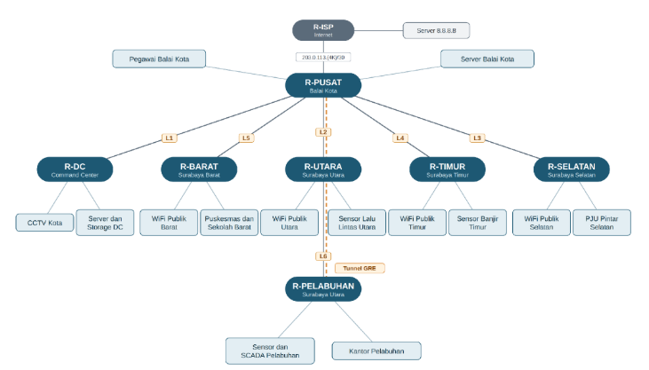

## Pengalamatan Jaringan

Seluruh subnet menggunakan hasil dari UTS setiap kelompok. Gateway setiap LAN adalah alamat host pertama. Berikut adalah alamat tambahan yang tidak dihitung saat UTS (K = nomor kelompok):

| No. | Keperluan | Alamat |
| :--- | :--- | :--- |
| 1 | **Link R-PUSAT ke R-ISP** | 203.0.113.(4 x K)/30 |
| 2 | **Server internet** | 8.8.8.0/24<br>Server 8.8.8.8, gateway 8.8.8.1 di R-ISP |
| 3 | **Tunnel GRE** | 192.168.K.0/30<br>Tunnel R-PUSAT .1, tunnel R-PELABUHAN .2 |

Karena kami adalah kelompok 1, maka alamatnya menjadi:

| No. | Keperluan | Alamat |
| :--- | :--- | :--- |
| 1 | **Link R-PUSAT ke R-ISP** | 203.0.113.4/30 |
| 2 | **Server internet** | 8.8.8.0/24<br>Server 8.8.8.8, gateway 8.8.8.1 di R-ISP |
| 3 | **Tunnel GRE** | 192.168.1.0/30<br>Tunnel R-PUSAT .1, tunnel R-PELABUHAN .2 |

## Kebutuhan IP

Tabel ini membedakan **kebutuhan host** pada 14 LAN sesuai soal dengan kapasitas usable subnet hasil VLSM. Nilai untuk link point-to-point dan server internet menunjukkan jumlah alamat host usable pada subnet tambahan tersebut; nilai-nilai itu bukan bagian dari total kebutuhan host LAN.

| Subnet | Lokasi | Host | Gateway (1=ya) | Kebutuhan alamat | Bit host | Prefix | Ukuran blok | Host valid |
| :--- | :--- | :---: | :---: | :---: | :---: | :---: | :---: | :---: |
| WiFi Publik Utara | R-UTARA | 11.000 | 1 | 11.003 | 14 | 18 | 16.384 | 16.382 |
| WiFi Publik Selatan | R-SELATAN | 6.500 | 1 | 6.503 | 13 | 19 | 8.192 | 8.190 |
| CCTV Kota | R-DC | 6.000 | 1 | 6.003 | 13 | 19 | 8.192 | 8.190 |
| WiFi Publik Timur | R-TIMUR | 5.500 | 1 | 5.503 | 13 | 19 | 8.192 | 8.190 |
| Sensor dan SCADA Pelabuhan | R-PELABUHAN | 5.000 | 1 | 5.003 | 13 | 19 | 8.192 | 8.190 |
| WiFi Publik Barat | R-BARAT | 4.500 | 1 | 4.503 | 13 | 19 | 8.192 | 8.190 |
| Pegawai Balai Kota | R-PUSAT | 1.800 | 1 | 1.803 | 11 | 21 | 2.048 | 2.046 |
| Sensor Banjir Timur | R-TIMUR | 700 | 1 | 703 | 10 | 22 | 1.024 | 1.022 |
| Sensor Lalu Lintas Utara | R-UTARA | 450 | 1 | 453 | 9 | 23 | 512 | 510 |
| Puskesmas dan Sekolah Barat | R-BARAT | 220 | 1 | 223 | 8 | 24 | 256 | 254 |
| Server dan Storage DC | R-DC | 180 | 1 | 183 | 8 | 24 | 256 | 254 |
| Kantor Pelabuhan | R-PELABUHAN | 120 | 1 | 123 | 7 | 25 | 128 | 126 |
| PJU Pintar Selatan | R-SELATAN | 90 | 1 | 93 | 7 | 25 | 128 | 126 |
| Server Balai Kota | R-PUSAT | 20 | 1 | 23 | 5 | 27 | 32 | 30 |
| L1 - PUSAT_DC | Link | 2 | 0 | 4 | 2 | 30 | 4 | 2 |
| L2 - PUSAT_UTARA | Link | 2 | 0 | 4 | 2 | 30 | 4 | 2 |
| L3 - PUSAT_SELATAN | Link | 2 | 0 | 4 | 2 | 30 | 4 | 2 |
| L4 - PUSAT_TIMUR | Link | 2 | 0 | 4 | 2 | 30 | 4 | 2 |
| L5 - PUSAT_BARAT | Link | 2 | 0 | 4 | 2 | 30 | 4 | 2 |
| L6 - UTARA_PELABUHAN | Link | 2 | 0 | 4 | 2 | 30 | 4 | 2 |
| Link R-PUSAT - R-ISP | Link | 2 | 0 | 4 | 2 | 30 | 4 | 2 |
| Server Internet | R-ISP | 1 | 1 | 4 | 8 | 24 | 256 | 254 |
| Tunnel GRE PUSAT–PELABUHAN | Link | 2 | 0 | 4 | 2 | 30 | 4 | 2 |
| **Total ukuran blok** | | | | | | | **62.016** | |

Subnet tambahan: Server Internet `8.8.8.0/24` menyediakan 254 host usable; WAN `203.0.113.4/30`, link L1–L6, dan GRE `192.168.1.0/30` masing-masing menyediakan 2 host usable.

Angka **62.016** di atas adalah jumlah ukuran blok subnet (termasuk network dan broadcast). Total **42.158** pada tabel rute adalah jumlah kebutuhan alamat yang dihitung dari host + gateway + network + broadcast untuk setiap subnet, sehingga kedua angka mengukur hal yang berbeda.


## Soal

### 1 - Perancangan Topologi

#### Deskripsi

* Bangun topologi di Cisco Packet Tracer sesuai skema yang kalian pilih (VLSM atau CIDR).
    * Hubungan antar-router (backbone, link L1–L6), termasuk R-ISP dan server 8.8.8.8, wajib mengikuti Gambar 1.
    * Desain setiap lokasi silakan dirancang sendiri, mencakup susunan switch, jenis perangkat yang dipasang (PC, perangkat mobile, atau server), media link (kabel atau wireless), serta penambahan port pada router. Tuliskan pertimbangan dan alasannya dalam dokumentasi.
    * Cukup pasang 1 perangkat perwakilan di setiap LAN. Perhitungan subnet tetap menggunakan jumlah host penuh.
* Ganti nama bawaan setiap perangkat (misalnya Router0, Switch1, PC2) dengan nama yang menunjukkan tempatnya, seperti R-PUSAT, SW-BALAIKOTA, atau PC-CCTV-KOTA.
* Tambahkan label di setiap LAN yang berisi nama subnet, Network ID/prefix, dan jumlah host.

#### Topologi yang Digunakan
Pada topologi jaringan yang kami bangun menggunakan Cisco Packet Tracer, kami memilih skema **VLSM (Variable Length Subnet Mask)** karena berdasarkan hasil perhitungan subnetting yang telah dilakukan, VLSM terbukti lebih efisien dalam penggunaan alamat IP dibandingkan skema CIDR dengan pembagian subnet berukuran seragam. VLSM memungkinkan setiap subnet memiliki ukuran yang berbeda sesuai dengan kebutuhan jumlah host pada masing-masing lokasi, sehingga dapat meminimalkan pemborosan alamat IP. Dengan demikian, alokasi alamat IP menjadi lebih optimal karena subnet dengan kebutuhan host sedikit tidak perlu mendapatkan kapasitas alamat IP yang terlalu besar, sementara subnet dengan kebutuhan host banyak tetap memperoleh kapasitas yang mencukupi.

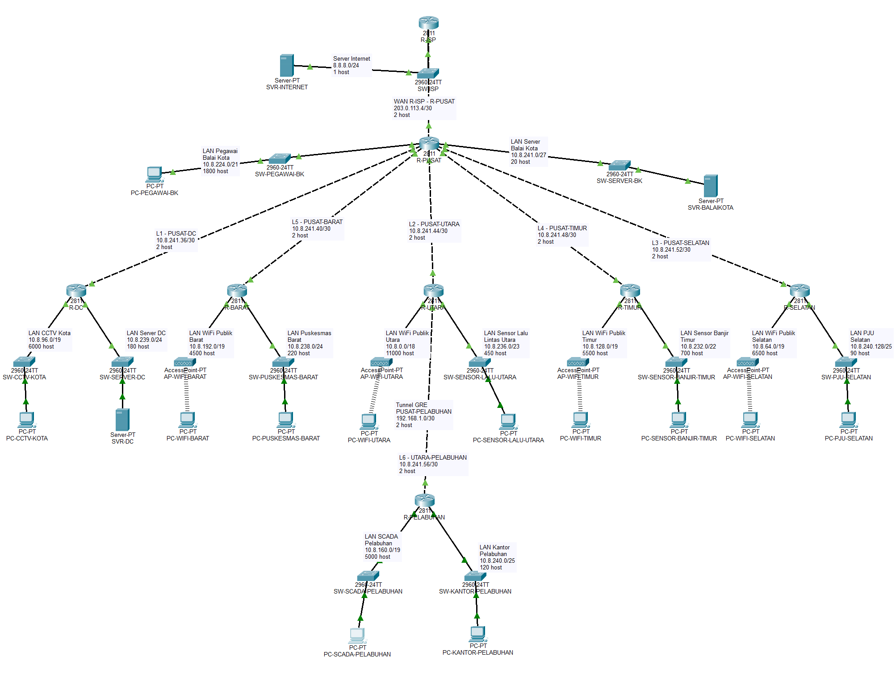

#### Pertimbangan Desain

Susunan switch dan jenis perangkat tiap lokasi:

* **ISP & Internet**: R-ISP tersambung ke SW-ISP, lalu SW-ISP ke SVR-INTERNET (8.8.8.8/24, gateway 8.8.8.1 di R-ISP). Server internet direpresentasikan satu perangkat perwakilan sesuai ketentuan soal.
* **Balai Kota**: dua LAN — LAN Pegawai Balai Kota (10.8.224.0/21, 2046 host) dengan perwakilan PC kabel, dan LAN Server Balai Kota (10.8.241.0/27, 30 host) dengan perwakilan server yang menampung layanan aplikasi kota cerdas.
* **Data Center**: LAN Server & Storage DC (10.8.239.0/24) dengan perwakilan server, dan LAN CCTV Kota (10.8.96.0/19) dengan perwakilan PC.
* **Barat / Utara / Timur / Selatan**: masing-masing dua LAN — satu LAN layanan kabel (Puskesmas & Sekolah 10.8.238.0/24, Sensor Lalu Lintas Utara 10.8.236.0/23, Sensor Banjir Timur 10.8.232.0/22, PJU Pintar Selatan 10.8.240.128/25) dengan perwakilan PC, dan satu LAN WiFi Publik (10.8.192.0/19, 10.8.0.0/18, 10.8.128.0/19, 10.8.64.0/19) dengan Access Point dan perwakilan PC ber-adaptor wireless.
* **Pelabuhan**: LAN SCADA Pelabuhan (10.8.160.0/19) dan LAN Kantor Pelabuhan (10.8.240.0/25), keduanya perwakilan PC kabel karena perangkat SCADA dan kantor pelabuhan bersifat tetap.

**Alasan pemilihan:**

* Switch yang dipakai adalah Cisco 2960-24TT karena menyediakan 24 port FastEthernet dan bersifat manageable, cukup untuk pertumbuhan tiap LAN sekaligus mendukung konfigurasi VLAN apabila diperlukan.
* LAN WiFi Publik dilayani media **wireless** karena mewakili area publik dengan pengguna bergerak (petugas dan warga), sehingga koneksi tanpa kabel lebih sesuai dengan fungsinya. LAN layanan internal (sensor, SCADA, kantor, PJU, CCTV, server) memakai media **kabel** karena perangkatnya bersifat tetap dan menuntut kestabilan tinggi.
* Access Point dicolok **langsung ke port router** (bukan lewat switch tambahan) karena sesuai ketentuan soal hanya ada satu perangkat perwakilan per LAN, sehingga switch di LAN wireless tidak memiliki client kabel apa pun dan hanya menambah perangkat tanpa fungsi.
* Client wireless memakai PC dengan modul Linksys-WMP300N; pemakaian PC alih-alih laptop/smartphone dilakukan agar konsisten dengan aturan "1 perangkat perwakilan per LAN" dan penamaan perangkat yang seragam, tanpa mengubah subnet, gateway, maupun mekanisme routing.

**Penambahan port pada router:**

* Router Cisco 2811 bawaan hanya memiliki 2 port FastEthernet, sedangkan kebutuhan tiap router lebih besar, sehingga dipasang modul tambahan.
* **R-PUSAT** membutuhkan 8 interface fisik: uplink ke R-ISP (203.0.113.4/30), 5 link backbone ke R-DC/R-BARAT/R-UTARA/R-TIMUR/R-SELATAN (L1–L5, masing-masing /30), dan 2 LAN Balai Kota. Tunnel GRE ke R-PELABUHAN (192.168.1.0/30) adalah interface logis di atas jalur underlay. Modul dipasang untuk menyediakan port `Ethernet0/0/0`–`Ethernet0/3/0` dan `FastEthernet1/0`–`FastEthernet1/1`.
* **R-UTARA** membutuhkan 4 interface: link L2, link L6 ke R-PELABUHAN, dan 2 LAN-nya — port `FastEthernet1/0` dan `FastEthernet1/1` ditambahkan lewat modul.
* Router lain (R-DC, R-BARAT, R-TIMUR, R-SELATAN, R-PELABUHAN) masing-masing membutuhkan 3 interface: 1–2 link backbone dan LAN-nya, dengan penambahan port serupa.
* Media backbone antar-router memakai kabel **crossover** karena menghubungkan perangkat sejenis (router–router), sedangkan koneksi router/PC/server ke switch memakai kabel **straight-through** sesuai aturan pin MDI/MDI-X.

### 2 - Tabel Subnetting

#### Deskripsi

* Menggunakan VLSM dan CIDR, buat tabel di spreadsheet yang berisi nama subnet, network ID, prefix, rentang host, alamat broadcast, dan gateway untuk setiap subnet sesuai dengan lembar jawaban UTS.
* Kesalahan hitung di UTS **boleh diperbaiki**, tetapi perbaikan wajib dicatat dalam **tabel revisi**: subnet, jawaban di UTS, perbaikan, dan alasan kesalahannya. Perubahan yang tidak dicatat dianggap sebagai "ketidakkonsistenan".
* 
#### File Excel

Untuk melihat proses subnetting dengan lebih lengkap, silakan melihat file **"Tabel Subnet_K1.xlsx"** .

#### Rute

| Nama Subnet | Rute | Jumlah IP | Netmask |
| :--- | :--- | ---: | :--- |
| A1 | R-PUSAT > SW-PEGAWAI-BK > PC-PEGAWAI-BK | 1.803 | /21 |
| A2 | R-PUSAT > SW-SERVER-BK > SVR-BALAIKOTA | 23 | /27 |
| A3 | R-DC > SW-CCTV-KOTA > PC-CCTV-KOTA | 6.003 | /19 |
| A4 | R-DC > SW-SERVER-DC > SVR-DC | 183 | /24 |
| A5 | R-BARAT > AP-WIFI-BARAT > PC-WIFI-BARAT | 4.503 | /19 |
| A6 | R-BARAT > SW-PUSKESMAS-BARAT > PC-PUSKESMAS-BARAT | 223 | /24 |
| A7 | R-UTARA > AP-WIFI-UTARA > PC-WIFI-UTARA | 11.003 | /18 |
| A8 | R-UTARA > SW-SENSOR-LALU-UTARA > PC-SENSOR-LALU-UTARA | 453 | /23 |
| A9 | R-TIMUR > AP-WIFI-TIMUR > PC-WIFI-TIMUR | 5.503 | /19 |
| A10 | R-TIMUR > SW-SENSOR-BANJIR-TIMUR > PC-SENSOR-BANJIR-TIMUR | 703 | /22 |
| A11 | R-SELATAN > AP-WIFI-SELATAN > PC-WIFI-SELATAN | 6.503 | /19 |
| A12 | R-SELATAN > SW-PJU-SELATAN > PC-PJU-SELATAN | 93 | /25 |
| A13 | R-PELABUHAN > SW-SCADA-PELABUHAN > PC-SCADA-PELABUHAN | 5.003 | /19 |
| A14 | R-PELABUHAN > SW-KANTOR-PELABUHAN > PC-KANTOR-PELABUHAN | 123 | /25 |
| A15 | R-ISP > SW-ISP > SVR-INTERNET | 4 | /24 |
| A16 | R-ISP > R-PUSAT (WAN publik 203.0.113.4/30) | 4 | /30 |
| A17 | R-PUSAT > R-DC (L1) | 4 | /30 |
| A18 | R-PUSAT > R-BARAT (L5) | 4 | /30 |
| A19 | R-PUSAT > R-UTARA (L2) | 4 | /30 |
| A20 | R-PUSAT > R-TIMUR (L4) | 4 | /30 |
| A21 | R-PUSAT > R-SELATAN (L3) | 4 | /30 |
| A22 | R-UTARA > R-PELABUHAN (L6) | 4 | /30 |
| A23 | R-PUSAT > R-PELABUHAN (Tunnel GRE) | 4 | /30 |
| A24 | R-DC > R-UTARA (L7 cadangan) | 4 | /30 |
| A25–A28 | R-PELABUHAN > R-TIMUR > R-SELATAN > R-BARAT > R-DC (L8–L11) | 16 | 4 x /30 |
| **Total kebutuhan alamat** | | **42.178** | — |

Catatan: kolom `Jumlah IP` mengikuti kolom `Kebutuhan alamat` pada tabel VLSM: kebutuhan host LAN ditambah 3 alamat (gateway, network ID, dan broadcast); server internet dan setiap subnet `/30` bernilai 4 alamat. Prefix tetap menunjukkan alokasi VLSM. Blok internal berada dalam `10.8.0.0/16`, tetapi `/16` bukan netmask gabungan untuk subnet WAN dan server internet.

#### VLSM

| Subnet | Prefix (angka) | Ukuran blok | Offset | Network | Mask | Prefix | Range host | Broadcast | Gateway |
|---|---:|---:|---:|---|---|---|---|---|---|
| WiFi Publik Utara | 18 | 16384 | 0 | 10.8.0.0 | 255.255.192.0 | /18 | 10.8.0.1 – 10.8.63.254 | 10.8.63.255 | 10.8.0.1 |
| WiFi Publik Selatan | 19 | 8192 | 16384 | 10.8.64.0 | 255.255.224.0 | /19 | 10.8.64.1 – 10.8.95.254 | 10.8.95.255 | 10.8.64.1 |
| CCTV Kota | 19 | 8192 | 24576 | 10.8.96.0 | 255.255.224.0 | /19 | 10.8.96.1 – 10.8.127.254 | 10.8.127.255 | 10.8.96.1 |
| WiFi Publik Timur | 19 | 8192 | 32768 | 10.8.128.0 | 255.255.224.0 | /19 | 10.8.128.1 – 10.8.159.254 | 10.8.159.255 | 10.8.128.1 |
| Sensor dan SCADA Pelabuhan | 19 | 8192 | 40960 | 10.8.160.0 | 255.255.224.0 | /19 | 10.8.160.1 – 10.8.191.254 | 10.8.191.255 | 10.8.160.1 |
| WiFi Publik Barat | 19 | 8192 | 49152 | 10.8.192.0 | 255.255.224.0 | /19 | 10.8.192.1 – 10.8.223.254 | 10.8.223.255 | 10.8.192.1 |
| Pegawai Balai Kota | 21 | 2048 | 57344 | 10.8.224.0 | 255.255.248.0 | /21 | 10.8.224.1 – 10.8.231.254 | 10.8.231.255 | 10.8.224.1 |
| Sensor Banjir Timur | 22 | 1024 | 59392 | 10.8.232.0 | 255.255.252.0 | /22 | 10.8.232.1 – 10.8.235.254 | 10.8.235.255 | 10.8.232.1 |
| Sensor Lalu Lintas Utara | 23 | 512 | 60416 | 10.8.236.0 | 255.255.254.0 | /23 | 10.8.236.1 – 10.8.237.254 | 10.8.237.255 | 10.8.236.1 |
| Puskesmas dan Sekolah Barat | 24 | 256 | 60928 | 10.8.238.0 | 255.255.255.0 | /24 | 10.8.238.1 – 10.8.238.254 | 10.8.238.255 | 10.8.238.1 |
| Server dan Storage DC | 24 | 256 | 61184 | 10.8.239.0 | 255.255.255.0 | /24 | 10.8.239.1 – 10.8.239.254 | 10.8.239.255 | 10.8.239.1 |
| Kantor Pelabuhan | 25 | 128 | 61440 | 10.8.240.0 | 255.255.255.128 | /25 | 10.8.240.1 – 10.8.240.126 | 10.8.240.127 | 10.8.240.1 |
| PJU Pintar Selatan | 25 | 128 | 61568 | 10.8.240.128 | 255.255.255.128 | /25 | 10.8.240.129 – 10.8.240.254 | 10.8.240.255 | 10.8.240.129 |
| Server Balai Kota | 27 | 32 | 61696 | 10.8.241.0 | 255.255.255.224 | /27 | 10.8.241.1 – 10.8.241.30 | 10.8.241.31 | 10.8.241.1 |
| L1 - PUSAT_DC | 30 | 4 | 61728 | 10.8.241.32 | 255.255.255.252 | /30 | 10.8.241.33 – 10.8.241.34 | 10.8.241.35 | — |
| L2 - PUSAT_UTARA | 30 | 4 | 61732 | 10.8.241.36 | 255.255.255.252 | /30 | 10.8.241.37 – 10.8.241.38 | 10.8.241.39 | — |
| L3 - PUSAT_SELATAN | 30 | 4 | 61736 | 10.8.241.40 | 255.255.255.252 | /30 | 10.8.241.41 – 10.8.241.42 | 10.8.241.43 | — |
| L4 - PUSAT_TIMUR | 30 | 4 | 61740 | 10.8.241.44 | 255.255.255.252 | /30 | 10.8.241.45 – 10.8.241.46 | 10.8.241.47 | — |
| L5 - PUSAT_BARAT | 30 | 4 | 61744 | 10.8.241.48 | 255.255.255.252 | /30 | 10.8.241.49 – 10.8.241.50 | 10.8.241.51 | — |
| L6 - UTARA_PELABUHAN | 30 | 4 | 61748 | 10.8.241.52 | 255.255.255.252 | /30 | 10.8.241.53 – 10.8.241.54 | 10.8.241.55 | — |
| L7 - DC_UTARA cadangan | 30 | 4 | 61756 | 10.8.241.60 | 255.255.255.252 | /30 | 10.8.241.61 – 10.8.241.62 | 10.8.241.63 | — |
| L8 - PELABUHAN_TIMUR | 30 | 4 | 61760 | 10.8.241.64 | 255.255.255.252 | /30 | 10.8.241.65 – 10.8.241.66 | 10.8.241.67 | — |
| L9 - TIMUR_SELATAN | 30 | 4 | 61764 | 10.8.241.68 | 255.255.255.252 | /30 | 10.8.241.69 – 10.8.241.70 | 10.8.241.71 | — |
| L10 - SELATAN_BARAT | 30 | 4 | 61768 | 10.8.241.72 | 255.255.255.252 | /30 | 10.8.241.73 – 10.8.241.74 | 10.8.241.75 | — |
| L11 - BARAT_DC | 30 | 4 | 61772 | 10.8.241.76 | 255.255.255.252 | /30 | 10.8.241.77 – 10.8.241.78 | 10.8.241.79 | — |

#### CIDR - Penggabungan

##### Penggabungan I

| Subnet | Gabungan 1 | Netmask 1 | Gabungan 2 | Netmask 2 | Netmask Akhir |
|---|---|---|---|---|---|
| B1 | A1 | /21 | A2 | /27 | /20 |
| B2 | A3 | /19 | A4 | /24 | /18 |
| B3 | A5 | /19 | A6 | /24 | /18 |
| B4 | A7 | /18 | A8 | /23 | /17 |
| B5 | A9 | /19 | A10 | /22 | /18 |
| B6 | A11 | /19 | A12 | /25 | /18 |
| B7 | A13 | /19 | A14 | /25 | /18 |
| B8 | A17 | /30 | A18 | /30 | /29 |
| B9 | A19 | /30 | A20 | /30 | /29 |
| B10 | A21 | /30 | A22 | /30 | /29 |

##### Penggabungan II

| Subnet | Gabungan 1 | Netmask 1 | Gabungan 2 | Netmask 2 | Netmask Akhir |
|---|---|---|---|---|---|
| C1 | B8 | /29 | B9 | /29 | /28 |
| C2 | C1 | /28 | B10 | /29 | /27 |
| C3 | B4 | /17 | B7 | /18 | /16 |
| C4 | B2 | /18 | B3 | /18 | /17 |
| C5 | B5 | /18 | B6 | /18 | /17 |

##### Penggabungan III

| Subnet | Gabungan 1 | Netmask 1 | Gabungan 2 | Netmask 2 | Netmask Akhir |
|---|---|---|---|---|---|
| D1 | B1 | /20 | C2 | /27 | /19 |
| D2 | C4 | /17 | C5 | /17 | /16 |

##### Penggabungan IV

| Subnet | Gabungan 1 | Netmask 1 | Gabungan 2 | Netmask 2 | Netmask Akhir |
|---|---|---|---|---|---|
| F1 | C3 | /16 | D2 | /16 | /15 |

##### Penggabungan V

| Subnet | Gabungan 1 | Netmask 1 | Gabungan 2 | Netmask 2 | Netmask Akhir |
|---|---|---|---|---|---|
| G1 | D1 | /19 | F1 | /15 | /14 |

#### CIDR - Pembagian IP


| Subnet | Prefix (angka) | Ukuran blok | Offset | Network | Mask | Prefix | Range host | Broadcast | Gateway |
|---|---:|---:|---:|---|---|---|---|---|---|
| Pegawai Balai Kota (A1) | 21 | 2048 | 0 | 10.8.0.0 | 255.255.248.0 | /21 | 10.8.0.1 – 10.8.7.254 | 10.8.7.255 | 10.8.0.1 |
| Server Balai Kota (A2) | 27 | 32 | 2048 | 10.8.8.0 | 255.255.255.224 | /27 | 10.8.8.1 – 10.8.8.30 | 10.8.8.31 | 10.8.8.1 |
| L1 - PUSAT_DC (A17) | 30 | 4 | 4096 | 10.8.16.0 | 255.255.255.252 | /30 | 10.8.16.1 – 10.8.16.2 | 10.8.16.3 | — |
| L5 - PUSAT_BARAT (A18) | 30 | 4 | 4100 | 10.8.16.4 | 255.255.255.252 | /30 | 10.8.16.5 – 10.8.16.6 | 10.8.16.7 | — |
| L2 - PUSAT_UTARA (A19) | 30 | 4 | 4104 | 10.8.16.8 | 255.255.255.252 | /30 | 10.8.16.9 – 10.8.16.10 | 10.8.16.11 | — |
| L4 - PUSAT_TIMUR (A20) | 30 | 4 | 4108 | 10.8.16.12 | 255.255.255.252 | /30 | 10.8.16.13 – 10.8.16.14 | 10.8.16.15 | — |
| L3 - PUSAT_SELATAN (A21) | 30 | 4 | 4112 | 10.8.16.16 | 255.255.255.252 | /30 | 10.8.16.17 – 10.8.16.18 | 10.8.16.19 | — |
| L6 - UTARA_PELABUHAN (A22) | 30 | 4 | 4116 | 10.8.16.20 | 255.255.255.252 | /30 | 10.8.16.21 – 10.8.16.22 | 10.8.16.23 | — |
| CCTV Kota (A3) | 19 | 8192 | 65536 | 10.9.0.0 | 255.255.224.0 | /19 | 10.9.0.1 – 10.9.31.254 | 10.9.31.255 | 10.9.0.1 |
| Server dan Storage DC (A4) | 24 | 256 | 73728 | 10.9.32.0 | 255.255.255.0 | /24 | 10.9.32.1 – 10.9.32.254 | 10.9.32.255 | 10.9.32.1 |
| WiFi Publik Barat (A5) | 19 | 8192 | 81920 | 10.9.64.0 | 255.255.224.0 | /19 | 10.9.64.1 – 10.9.95.254 | 10.9.95.255 | 10.9.64.1 |
| Puskesmas dan Sekolah Barat (A6) | 24 | 256 | 90112 | 10.9.96.0 | 255.255.255.0 | /24 | 10.9.96.1 – 10.9.96.254 | 10.9.96.255 | 10.9.96.1 |
| WiFi Publik Timur (A9) | 19 | 8192 | 98304 | 10.9.128.0 | 255.255.224.0 | /19 | 10.9.128.1 – 10.9.159.254 | 10.9.159.255 | 10.9.128.1 |
| Sensor Banjir Timur (A10) | 22 | 1024 | 106496 | 10.9.160.0 | 255.255.252.0 | /22 | 10.9.160.1 – 10.9.163.254 | 10.9.163.255 | 10.9.160.1 |
| WiFi Publik Selatan (A11) | 19 | 8192 | 114688 | 10.9.192.0 | 255.255.224.0 | /19 | 10.9.192.1 – 10.9.223.254 | 10.9.223.255 | 10.9.192.1 |
| PJU Pintar Selatan (A12) | 25 | 128 | 122880 | 10.9.224.0 | 255.255.255.128 | /25 | 10.9.224.1 – 10.9.224.126 | 10.9.224.127 | 10.9.224.1 |
| WiFi Publik Utara (A7) | 18 | 16384 | 131072 | 10.10.0.0 | 255.255.192.0 | /18 | 10.10.0.1 – 10.10.63.254 | 10.10.63.255 | 10.10.0.1 |
| Sensor Lalu Lintas Utara (A8) | 23 | 512 | 147456 | 10.10.64.0 | 255.255.254.0 | /23 | 10.10.64.1 – 10.10.65.254 | 10.10.65.255 | 10.10.64.1 |
| Sensor dan SCADA Pelabuhan (A13) | 19 | 8192 | 163840 | 10.10.128.0 | 255.255.224.0 | /19 | 10.10.128.1 – 10.10.159.254 | 10.10.159.255 | 10.10.128.1 |
| Kantor Pelabuhan (A14) | 25 | 128 | 172032 | 10.10.160.0 | 255.255.255.128 | /25 | 10.10.160.1 – 10.10.160.126 | 10.10.160.127 | 10.10.160.1 |
| Server Internet (A15) | 24 | 256 | — | 8.8.8.0 | 255.255.255.0 | /24 | 8.8.8.1 – 8.8.8.254 | 8.8.8.255 | 8.8.8.1 |
| Link R-PUSAT - R-ISP (A16) | 30 | 4 | — | 203.0.113.4 | 255.255.255.252 | /30 | 203.0.113.5 – 203.0.113.6 | 203.0.113.7 | — |
| Tunnel GRE PUSAT–PELABUHAN (A23) | 30 | 4 | — | 192.168.1.0 | 255.255.255.252 | /30 | 192.168.1.1 – 192.168.1.2 | 192.168.1.3 | — |


### 3 - Static Routing

#### Deskripsi
* Pada tahap soal 3, seluruh LAN dapat saling berkomunikasi dengan static route (dan default route untuk arah keluar). Pada tahap soal 7, route internal diganti dengan OSPF.
* Default route hanya boleh mengarah ke router di atasnya / keluar. Misalnya, default route R-DC ke R-PUSAT, R-PELABUHAN ke R-UTARA, dan R-PUSAT ke R-ISP.
* R-PUSAT dan R-UTARA wajib memiliki static route ke jaringan di bawahnya (ke dalam):
    * R-PUSAT: ke semua LAN milik R-DC, R-UTARA, R-PELABUHAN, R-SELATAN, R-TIMUR, dan R-BARAT.
    * R-UTARA: ke semua LAN milik R-PELABUHAN.

#### Konfigurasi tahap soal 3 (historis)

Konfigurasi berikut adalah static routing sebelum migrasi OSPF pada soal 7.


| Link | Subnet aktif CPT | Alamat interface router |
| :--- | :--- | :--- |
| WAN R-ISP–R-PUSAT | `203.0.113.4/30` | R-ISP `203.0.113.5`, R-PUSAT `203.0.113.6` |
| L1 PUSAT–DC | `10.8.241.36/30` | R-PUSAT `10.8.241.37`, R-DC `10.8.241.38` |
| L5 PUSAT–BARAT | `10.8.241.40/30` | R-PUSAT `10.8.241.41`, R-BARAT `10.8.241.42` |
| L2 PUSAT–UTARA | `10.8.241.44/30` | R-PUSAT `10.8.241.45`, R-UTARA `10.8.241.46` |
| L4 PUSAT–TIMUR | `10.8.241.48/30` | R-PUSAT `10.8.241.49`, R-TIMUR `10.8.241.50` |
| L3 PUSAT–SELATAN | `10.8.241.52/30` | R-PUSAT `10.8.241.53`, R-SELATAN `10.8.241.54` |
| L6 UTARA–PELABUHAN | `10.8.241.56/30` | R-UTARA `10.8.241.57`, R-PELABUHAN `10.8.241.58` |
| L7 DC–UTARA (cadangan) | `10.8.241.60/30` | R-DC `10.8.241.61`, R-UTARA `10.8.241.62` |
| L8 PELABUHAN–TIMUR | `10.8.241.64/30` | R-PELABUHAN `10.8.241.65`, R-TIMUR `10.8.241.66` |
| L9 TIMUR–SELATAN | `10.8.241.68/30` | R-TIMUR `10.8.241.69`, R-SELATAN `10.8.241.70` |
| L10 SELATAN–BARAT | `10.8.241.72/30` | R-SELATAN `10.8.241.73`, R-BARAT `10.8.241.74` |
| L11 BARAT–DC | `10.8.241.76/30` | R-BARAT `10.8.241.77`, R-DC `10.8.241.78` |

Gateway LAN memakai alamat pertama subnet: R-PUSAT `10.8.224.1` dan `10.8.241.1`; R-DC `10.8.96.1`, `10.8.239.1`; R-BARAT `10.8.192.1`, `10.8.238.1`; R-UTARA `10.8.0.1`, `10.8.236.1`; R-TIMUR `10.8.128.1`, `10.8.232.1`; R-SELATAN `10.8.64.1`, `10.8.240.129`; R-PELABUHAN `10.8.160.1`, `10.8.240.1`.

Empat PC WiFi memperoleh alamat dari pool DHCP router pada port `Wireless0`:

| Perangkat | IP / Mask | Default gateway | DNS |
| :--- | :--- | :--- | :--- |
| PC-WIFI-UTARA | `10.8.0.2` / `255.255.192.0` | `10.8.0.1` | `8.8.8.8` |
| PC-WIFI-SELATAN | `10.8.64.2` / `255.255.224.0` | `10.8.64.1` | `8.8.8.8` |
| PC-WIFI-TIMUR | `10.8.128.2` / `255.255.224.0` | `10.8.128.1` | `8.8.8.8` |
| PC-WIFI-BARAT | `10.8.192.2` / `255.255.224.0` | `10.8.192.1` | `8.8.8.8` |

Alamat tersebut berasal dari lease DHCP, bukan konfigurasi statis, lease-nya juga terlihat pada binding router di soal 4.

##### Tambahan untuk koneksi internet

Route balik ini dipasang di **R-ISP** agar balasan dari jaringan internet dapat kembali ke jaringan internal. Ini konfigurasi pendukung akses internet, bukan syarat pembuktian komunikasi antar-LAN pada soal 3. Rute ini dihapus kembali pada soal 5 setelah NAT aktif.

```text
enable
configure terminal
ip route 10.8.0.0 255.255.0.0 203.0.113.6
end
```

##### R-PUSAT

Default route mengirim tujuan yang tidak dikenal ke R-ISP. Pada tahap soal 3, static route di bawah mencakup LAN cabang, termasuk LAN Pelabuhan melalui R-UTARA. Rute-rute ini adalah konfigurasi historis; pada soal 7 route internal dipelajari melalui OSPF.

```text
enable
configure terminal
ip route 10.8.96.0 255.255.224.0 10.8.241.38
ip route 10.8.239.0 255.255.255.0 10.8.241.38
ip route 10.8.192.0 255.255.224.0 10.8.241.42
ip route 10.8.238.0 255.255.255.0 10.8.241.42
ip route 10.8.0.0 255.255.192.0 10.8.241.46
ip route 10.8.236.0 255.255.254.0 10.8.241.46
ip route 10.8.160.0 255.255.224.0 10.8.241.46
ip route 10.8.240.0 255.255.255.128 10.8.241.46
ip route 10.8.241.56 255.255.255.252 10.8.241.46
ip route 10.8.241.58 255.255.255.255 10.8.241.46
ip route 10.8.128.0 255.255.224.0 10.8.241.50
ip route 10.8.232.0 255.255.252.0 10.8.241.50
ip route 10.8.64.0 255.255.224.0 10.8.241.54
ip route 10.8.240.128 255.255.255.128 10.8.241.54
ip route 0.0.0.0 0.0.0.0 203.0.113.5
end
```

##### R-UTARA

R-UTARA merutekan kedua LAN Pelabuhan ke router Pelabuhan melalui L6. Default route mengarah ke atas, ke R-PUSAT.

```text
enable
configure terminal
ip route 10.8.160.0 255.255.224.0 10.8.241.58
ip route 10.8.240.0 255.255.255.128 10.8.241.58
ip route 0.0.0.0 0.0.0.0 10.8.241.45
end
```

##### Router cabang dan R-PELABUHAN

Kode beriktu dijalnkan di blok masing-masing pada router yang disebutkan. Cabang selain Pelabuhan mengirim tujuan di luar jaringan lokal ke R-PUSAT; R-PELABUHAN mengirimnya ke R-UTARA melalui L6.

**Pada R-DC:**
```text
enable
configure terminal
ip route 0.0.0.0 0.0.0.0 10.8.241.37
end
```

**Pada R-BARAT:**
```text
enable
configure terminal
ip route 0.0.0.0 0.0.0.0 10.8.241.41
end
```

**Pada R-TIMUR:**
```text
enable
configure terminal
ip route 0.0.0.0 0.0.0.0 10.8.241.49
end
```

**Pada R-SELATAN:**
```text
enable
configure terminal
ip route 0.0.0.0 0.0.0.0 10.8.241.53
end
```

**Pada R-PELABUHAN:**
```text
enable
configure terminal
ip route 0.0.0.0 0.0.0.0 10.8.241.57
end
```

Default route tiap perangkat cabang adalah route statis dengan prefix `/0` dan ditandai `S*` pada tabel routing. Jika konfigurasi lama perlu dibersihkan sebelum memasukkan ulang perintah, hapus hanya route yang sama menggunakan `no ip route` dengan network, mask, dan next-hop yang sama. Tidak ada route dinamis OSPF yang dipakai untuk memenuhi soal ini.

#### Verifikasi

##### Static route R-PUSAT ke LAN cabang

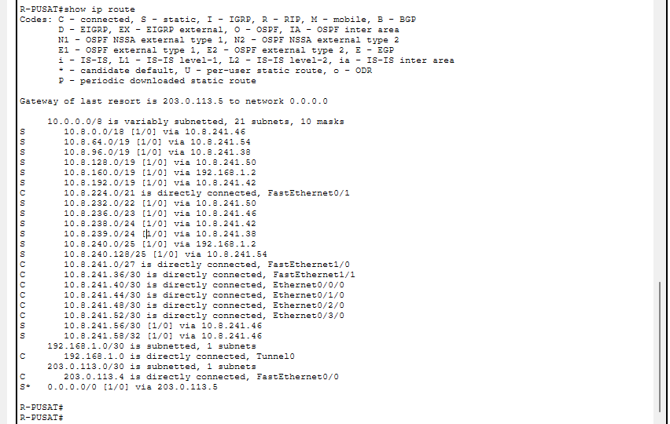

Tabel ini menunjukkan routing pada tahap soal 3. R-PUSAT memiliki static route ke setiap LAN cabang yang tidak terhubung langsung. LAN Utara (`10.8.0.0/18` dan `10.8.236.0/23`) serta LAN Pelabuhan (`10.8.160.0/19`) diarahkan melalui R-UTARA `10.8.241.46`; LAN Selatan (`10.8.64.0/19`) melalui R-SELATAN `10.8.241.54`; LAN DC (`10.8.96.0/19` dan `10.8.239.0/24`) melalui R-DC `10.8.241.38`; LAN Timur (`10.8.128.0/19` dan `10.8.232.0/22`) melalui R-TIMUR `10.8.241.50`; serta LAN Barat (`10.8.192.0/19` dan `10.8.238.0/24`) melalui R-BARAT `10.8.241.42`. LAN Kantor Pelabuhan (`10.8.240.0/25`) menggunakan R-PELABUHAN `192.168.1.2` melalui Tunnel0. LAN Pegawai Balai Kota (`10.8.224.0/21`) dan Server Balai Kota (`10.8.241.0/27`) terhubung langsung ke R-PUSAT, sehingga ditandai `C`, bukan static route.

Default route `S* 0.0.0.0/0` mengarah ke R-ISP `203.0.113.5` untuk tujuan yang tidak tercakup oleh route yang lebih spesifik. Screenshot ini menampilkan seluruh tabel routing, termasuk route ke `10.8.241.58/32` melalui R-UTARA untuk endpoint underlay GRE R-PELABUHAN. Route internal pada tahap ini adalah konfigurasi static routing soal 3; pada tahap soal 7, route internal digantikan OSPF.

##### Static route R-UTARA ke LAN Pelabuhan dan default route

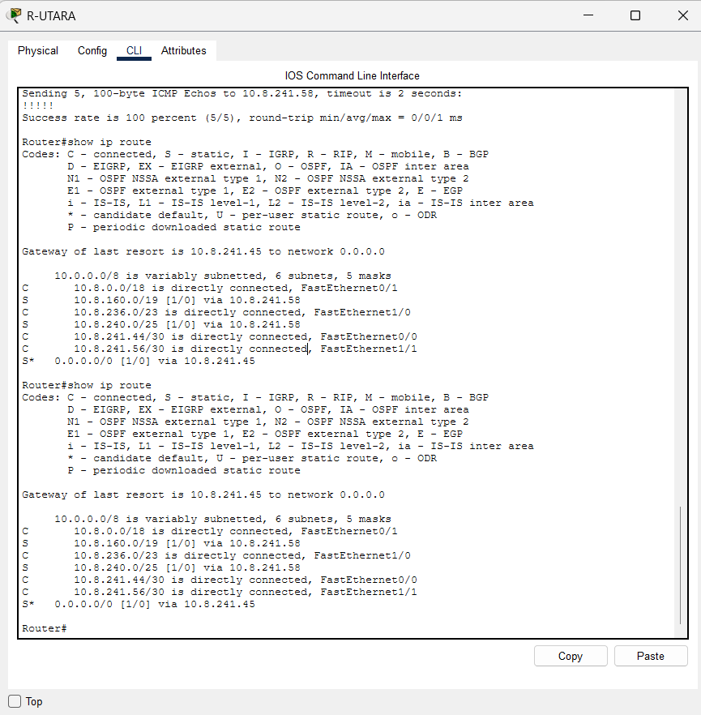

Gambar di atas memperlihatkan ping ke `10.8.241.58` dengan `5/5` balasan, static route `10.8.160.0/19` dan `10.8.240.0/25` via `10.8.241.58`, serta default route `S* 0.0.0.0/0` via `10.8.241.45`. R-UTARA mengarahkan LAN Pelabuhan ke R-PELABUHAN dan tujuan lain ke R-PUSAT.

##### Default route router cabang

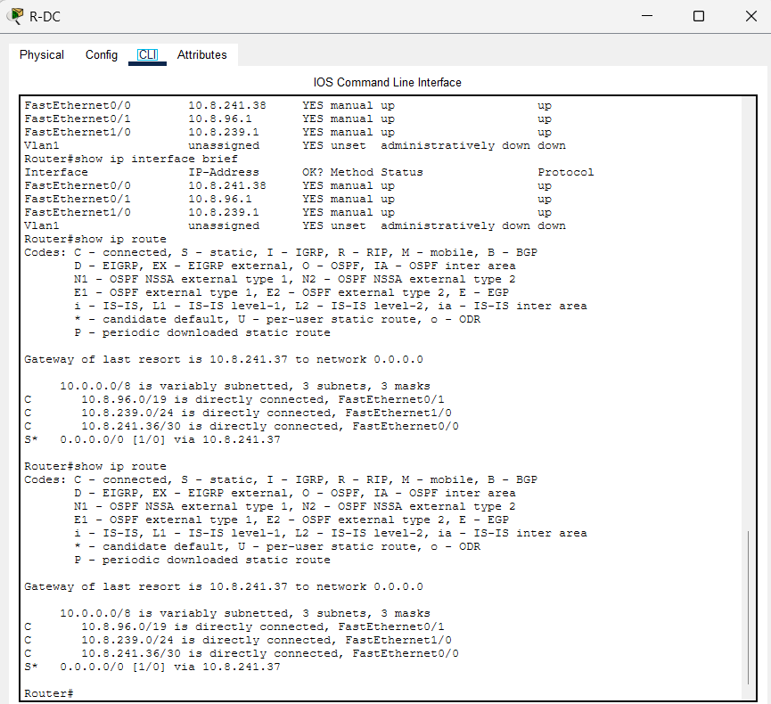

Gambar di atas menunjukkan R-DC hanya memiliki connected route `10.8.96.0/19`, `10.8.239.0/24`, dan `10.8.241.36/30`, dengan default route `S*` via `10.8.241.37`.

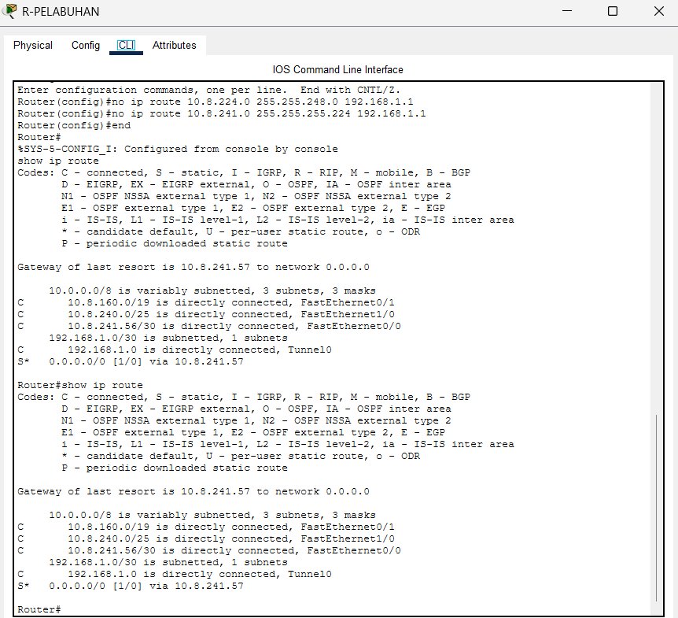

Gambar di atas menunjukkan R-PELABUHAN memiliki connected route `10.8.160.0/19`, `10.8.240.0/25`, `10.8.241.56/30`, dan `192.168.1.0/30` pada `Tunnel0`, dengan default route `S*` via `10.8.241.57`. Pada kedua gambar di atas tidak tampak static route lain; tujuan di luar LAN dikirim ke router di atasnya.

##### Ping antar-LAN

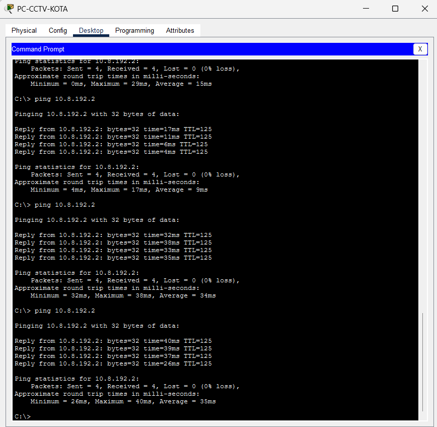

Gambar di atas menunjukkan PC-CCTV-KOTA (`10.8.96.2`) mendapat `4/4` balasan dari PC-WIFI-BARAT (`10.8.192.2`). Hasil ini membuktikan static route R-PUSAT menuju LAN Barat dan route balik R-BARAT berfungsi.

##### Ping dua arah Balai Kota–Pelabuhan

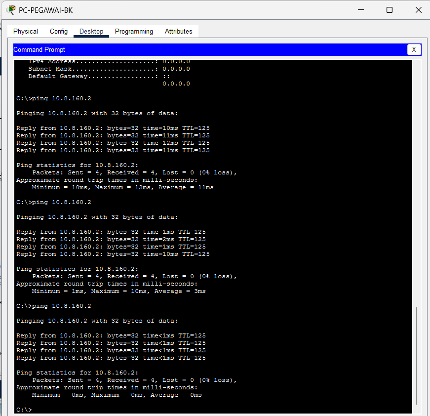

Gambar di atas menunjukkan PC-PEGAWAI-BK (`10.8.224.2`) mendapat `4/4` balasan dari PC-SCADA-PELABUHAN (`10.8.160.2`). Pada tahap static routing, trafik melewati R-PUSAT–R-UTARA–R-PELABUHAN.


Gambar di atas menunjukkan arah balik dari PC-SCADA-PELABUHAN (`10.8.160.2`) ke PC-PEGAWAI-BK (`10.8.224.2`) juga mendapat `4/4` balasan. Setelah GRE aktif, jalur Balai Kota–Pelabuhan melewati `Tunnel0`, seperti terlihat pada verifikasi soal 6.

##### Bukti tambahan akses internet

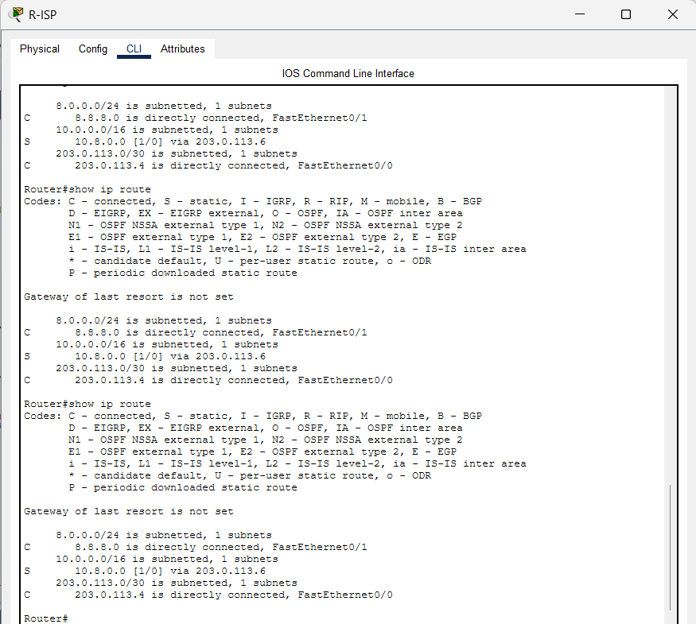

Gambar di atas menunjukkan route balik `S 10.8.0.0/16 via 203.0.113.6` yang dipasang pada tahap soal 3 agar balasan internet kembali ke jaringan internal. Rute ini dihapus pada soal 5 setelah NAT aktif.

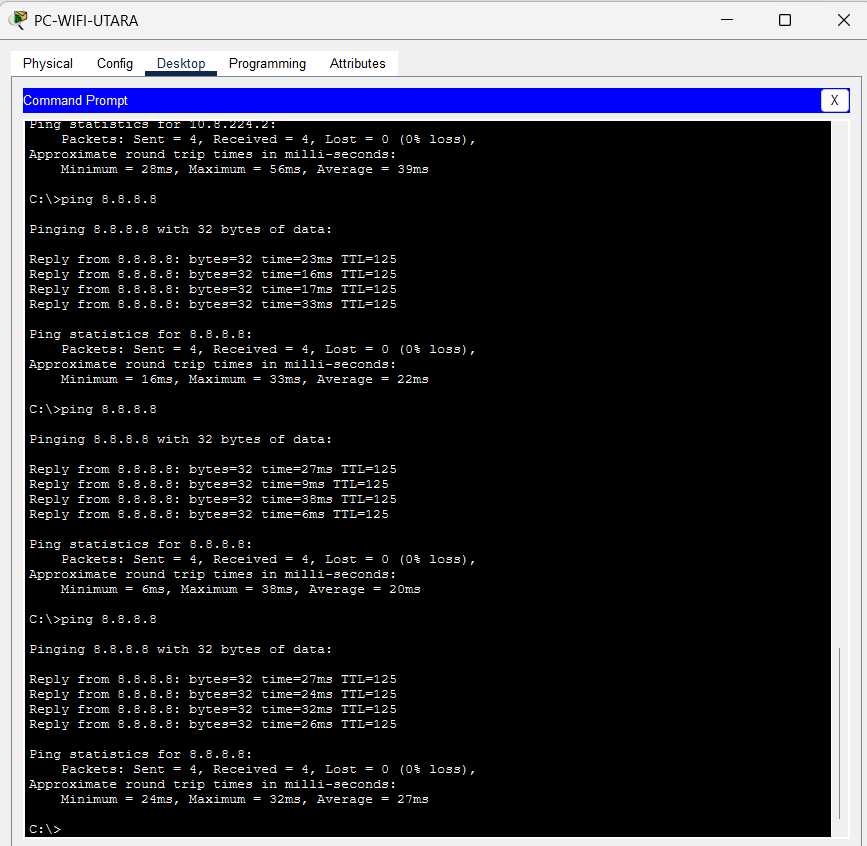

Gambar di atas menunjukkan PC-WIFI-UTARA mendapat `4/4` balasan dari `8.8.8.8`, yang juga membuktikan tujuan internet melewati default route R-PUSAT ke R-ISP.

Beberapa gambar diambil sebelum hostname perangkat diubah, sehingga prompt CLI masih `Router#`; nama perangkat yang benar terlihat pada judul jendela.

### 4 - DHCP

#### Deskripsi
* Interface router dan seluruh server menggunakan **IP statis**.
* Perangkat pengguna mendapat **IP dinamis** secara otomatis, lengkap dengan gateway dan DNS server (soal 8), tanpa bentrok dengan alamat IP statis.
* Khusus untuk subnet CCTV Kota (subnet R-DC) mendapatkan alamat dari server DHCP di LAN Server dan Storage DC, bukan dari router.
* 
#### Penyelesaian

Gateway setiap LAN tetap statis di interface router. Server juga tetap statis: SVR-BALAIKOTA `10.8.241.2/27`, SVR-DC `10.8.239.2/24`, dan SVR-INTERNET `8.8.8.8/24`. DHCP router membagikan alamat untuk LAN pengguna; pool mengecualikan gateway saja, sesuai skema soal. Semua pool memberikan DNS `8.8.8.8`.

##### Pemetaan subnet dan metode DHCP

| Router | LAN / subnet | Gateway | Server statis | DHCP |
| :--- | :--- | :--- | :--- | :--- |
| R-PUSAT | Pegawai Balai Kota `10.8.224.0/21` | `10.8.224.1` | - | Pool router `POOL-PEGAWAI-BK`; exclude `.1` |
| R-PUSAT | Server Balai Kota `10.8.241.0/27` | `10.8.241.1` | SVR-BALAIKOTA `10.8.241.2` | Statis, tidak memakai DHCP |
| R-DC | CCTV Kota `10.8.96.0/19` | `10.8.96.1` | - | Pool `serverPool` pada SVR-DC `10.8.239.2`, relay `ip helper-address` |
| R-DC | Server dan Storage `10.8.239.0/24` | `10.8.239.1` | SVR-DC `10.8.239.2` | Statis; pool default untuk subnet server dipertahankan, klien tidak diset DHCP |
| R-BARAT | WiFi Publik Barat `10.8.192.0/19` | `10.8.192.1` | - | Pool router `POOL-WIFI-BARAT`; exclude `.1` |
| R-BARAT | Puskesmas dan Sekolah `10.8.238.0/24` | `10.8.238.1` | - | Pool router `POOL-PUSKESMAS-BARAT`; exclude `.1` |
| R-UTARA | WiFi Publik Utara `10.8.0.0/18` | `10.8.0.1` | - | Pool router `POOL-WIFI-UTARA`; exclude `.1` |
| R-UTARA | Sensor Lalu Lintas `10.8.236.0/23` | `10.8.236.1` | - | Pool router `POOL-SENSOR-UTARA`; exclude `.1` |
| R-TIMUR | WiFi Publik Timur `10.8.128.0/19` | `10.8.128.1` | - | Pool router `POOL-WIFI-TIMUR`; exclude `.1` |
| R-TIMUR | Sensor Banjir `10.8.232.0/22` | `10.8.232.1` | - | Pool router `POOL-BANJIR-TIMUR`; exclude `.1` |
| R-SELATAN | WiFi Publik Selatan `10.8.64.0/19` | `10.8.64.1` | - | Pool router `POOL-WIFI-SELATAN`; exclude `.1` |
| R-SELATAN | PJU Pintar `10.8.240.128/25` | `10.8.240.129` | - | Pool router `POOL-PJU-SELATAN`; exclude `.129` |
| R-PELABUHAN | Sensor dan SCADA `10.8.160.0/19` | `10.8.160.1` | - | Pool router `POOL-SCADA-PELABUHAN`; exclude `.1` |
| R-PELABUHAN | Kantor Pelabuhan `10.8.240.0/25` | `10.8.240.1` | - | Pool router `POOL-KANTOR-PELABUHAN`; exclude `.1` |
| R-ISP | Server Internet `8.8.8.0/24` | `8.8.8.1` | SVR-INTERNET `8.8.8.8` | Statis, tidak memakai DHCP |

Empat PC WiFi perwakilan memperoleh lease dari pool router pada interface `Wireless0` dengan alamat `10.8.x.2`. Lease DHCP untuk LAN kabel, WiFi, dan CCTV terlihat pada bagian verifikasi.

##### DHCP server terpusat CCTV

SVR-DC berada pada alamat statis `10.8.239.2/24`, gateway `10.8.239.1`, DNS `8.8.8.8`. Layanan DHCP diaktifkan pada port `FastEthernet0`. Pool default `serverPool` dikonfigurasi untuk CCTV dengan gateway `10.8.96.1`, DNS `8.8.8.8`, start IP `10.8.96.2`, mask `255.255.224.0`, maksimum 6000 lease. Pool terpisah bernama `CCTV-KOTA` yang tersisa dari konfigurasi sebelumnya dipakai untuk LAN server/storage (`10.8.239.10`, mask `/24`, gateway `10.8.239.1`, DNS `8.8.8.8`, maksimum 240); klien server tetap dikonfigurasi statis.

Pada interface R-DC yang menuju LAN CCTV, FastEthernet0/1 di CPT, relay meneruskan broadcast DHCP ke server lintas subnet:

```text
enable
configure terminal
interface FastEthernet0/1
 ip helper-address 10.8.239.2
end
```

Pool server di Packet Tracer menggunakan nama default `serverPool`; konfigurasi DHCP API tidak menyediakan operasi hapus pool, jadi pool CCTV tambahan tidak dapat dihapus dengan cara yang didukung tool. Pool yang dipakai klien CCTV tetap `serverPool`, sesuai nama default yang diminta.

##### DHCP pool pada router

Jalankan exclusions dan pool berikut pada router yang disebut. `ip dhcp excluded-address` mencegah gateway statis diberikan ke klien. Pool lain pada router mengikuti pola yang sama, masing-masing dengan `network`, `default-router` gateway subnet, dan `dns-server 8.8.8.8`.

**R-PUSAT:**
```text
enable
configure terminal
ip dhcp excluded-address 10.8.224.1
ip dhcp pool POOL-PEGAWAI-BK
 network 10.8.224.0 255.255.248.0
 default-router 10.8.224.1
 dns-server 8.8.8.8
end
```

**R-BARAT:**
```text
enable
configure terminal
ip dhcp excluded-address 10.8.192.1
ip dhcp excluded-address 10.8.238.1
ip dhcp pool POOL-WIFI-BARAT
 network 10.8.192.0 255.255.224.0
 default-router 10.8.192.1
 dns-server 8.8.8.8
ip dhcp pool POOL-PUSKESMAS-BARAT
 network 10.8.238.0 255.255.255.0
 default-router 10.8.238.1
 dns-server 8.8.8.8
end
```

**R-UTARA:**
```text
enable
configure terminal
ip dhcp excluded-address 10.8.0.1
ip dhcp excluded-address 10.8.236.1
ip dhcp pool POOL-WIFI-UTARA
 network 10.8.0.0 255.255.192.0
 default-router 10.8.0.1
 dns-server 8.8.8.8
ip dhcp pool POOL-SENSOR-UTARA
 network 10.8.236.0 255.255.254.0
 default-router 10.8.236.1
 dns-server 8.8.8.8
end
```

**R-TIMUR:**
```text
enable
configure terminal
ip dhcp excluded-address 10.8.128.1
ip dhcp excluded-address 10.8.232.1
ip dhcp pool POOL-WIFI-TIMUR
 network 10.8.128.0 255.255.224.0
 default-router 10.8.128.1
 dns-server 8.8.8.8
ip dhcp pool POOL-BANJIR-TIMUR
 network 10.8.232.0 255.255.252.0
 default-router 10.8.232.1
 dns-server 8.8.8.8
end
```

**R-SELATAN:**
```text
enable
configure terminal
ip dhcp excluded-address 10.8.64.1
ip dhcp excluded-address 10.8.240.129
ip dhcp pool POOL-WIFI-SELATAN
 network 10.8.64.0 255.255.224.0
 default-router 10.8.64.1
 dns-server 8.8.8.8
ip dhcp pool POOL-PJU-SELATAN
 network 10.8.240.128 255.255.255.128
 default-router 10.8.240.129
 dns-server 8.8.8.8
end
```

**R-PELABUHAN:**
```text
enable
configure terminal
ip dhcp excluded-address 10.8.160.1
ip dhcp excluded-address 10.8.240.1
ip dhcp pool POOL-SCADA-PELABUHAN
 network 10.8.160.0 255.255.224.0
 default-router 10.8.160.1
 dns-server 8.8.8.8
ip dhcp pool POOL-KANTOR-PELABUHAN
 network 10.8.240.0 255.255.255.128
 default-router 10.8.240.1
 dns-server 8.8.8.8
end
```

##### Pengaturan perangkat pengguna

PC pengguna pada LAN kabel dan empat PC WiFi memakai **Desktop > IP Configuration > DHCP**; untuk WiFi, konfigurasi dilakukan pada interface `Wireless0`. Server tidak diubah ke DHCP.

#### Verifikasi

##### Lease CCTV dari DHCP server terpusat

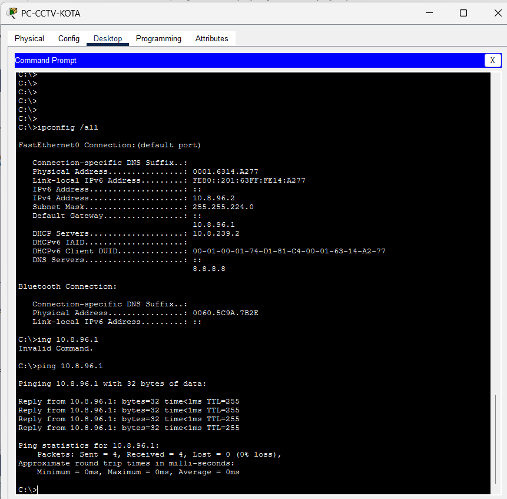

Gambar di atas menunjukkan PC-CCTV-KOTA memperoleh IPv4 `10.8.96.2`, mask `255.255.224.0`, gateway `10.8.96.1`, DHCP Server `10.8.239.2`, dan DNS `8.8.8.8`. Ping ke gateway `10.8.96.1` mendapat `4/4` balasan. Lease ini berasal dari SVR-DC melalui relay R-DC, bukan dari pool lokal R-DC.

##### DHCP relay pada R-DC

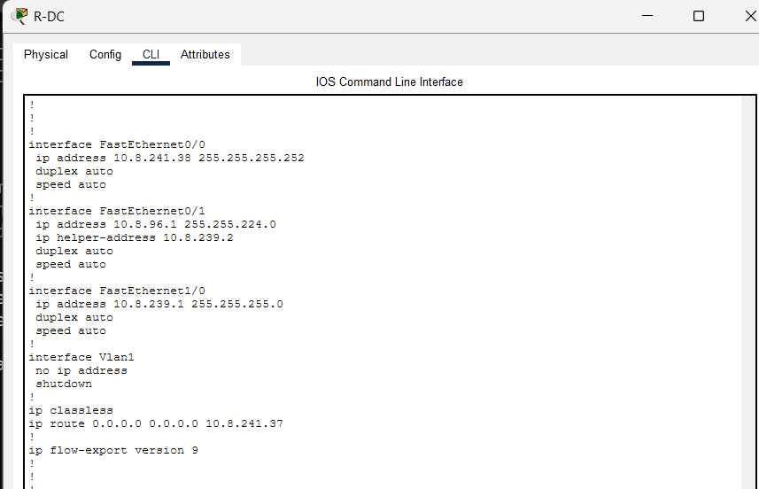

Gambar di atas menunjukkan interface `FastEthernet0/1` R-DC memakai `10.8.96.1 255.255.224.0` dan memiliki `ip helper-address 10.8.239.2`. Alamat helper menunjuk SVR-DC, sehingga broadcast DHCP dari LAN CCTV diteruskan lintas subnet ke server terpusat.

##### Pool DHCP pada SVR-DC

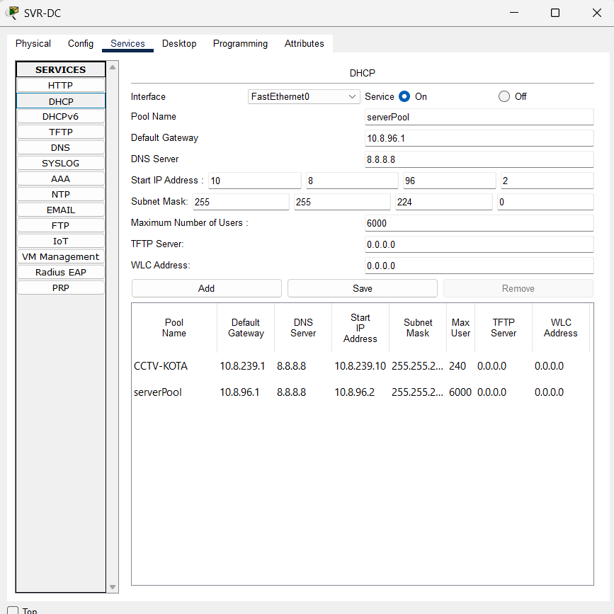

Gambar di atas menunjukkan layanan DHCP SVR-DC aktif. Pool `serverPool` melayani CCTV dengan gateway `10.8.96.1`, DNS `8.8.8.8`, start IP `10.8.96.2`, mask `255.255.224.0`, dan maksimum 6000 lease. Pool `CCTV-KOTA` adalah pool tambahan untuk subnet server/storage (`10.8.239.0/24`), bukan pool yang melayani klien CCTV.

##### Binding DHCP pada router

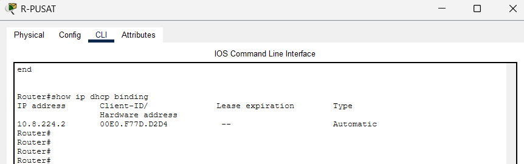

Gambar di atas menunjukkan binding R-PUSAT untuk Pegawai Balai Kota `10.8.224.2` dengan tipe `Automatic`.

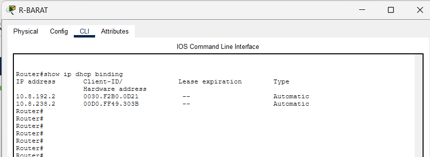

Gambar di atas menunjukkan binding R-BARAT untuk WiFi Barat `10.8.192.2` dan Puskesmas Barat `10.8.238.2`, keduanya bertipe `Automatic`.

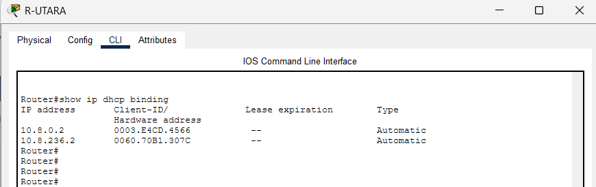

Gambar di atas menunjukkan binding R-UTARA untuk WiFi Utara `10.8.0.2` dan Sensor Lalu Lintas `10.8.236.2`, keduanya bertipe `Automatic`.

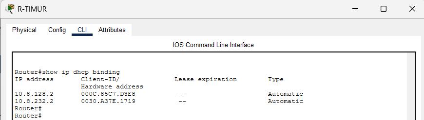

Gambar di atas menunjukkan binding R-TIMUR untuk WiFi Timur `10.8.128.2` dan Sensor Banjir `10.8.232.2`, keduanya bertipe `Automatic`.

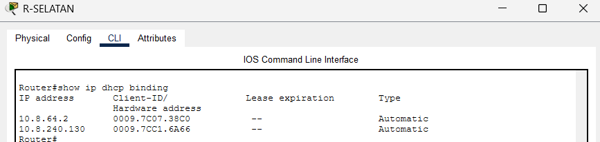

Gambar di atas menunjukkan binding R-SELATAN untuk WiFi Selatan `10.8.64.2` dan PJU `10.8.240.130`, keduanya bertipe `Automatic`.

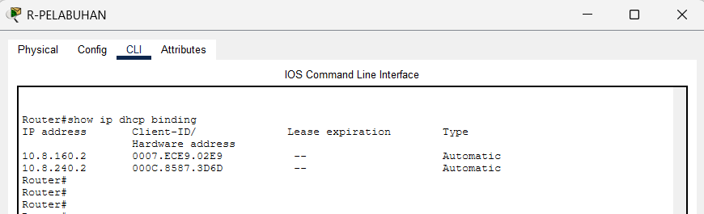

Gambar di atas menunjukkan binding R-PELABUHAN untuk SCADA `10.8.160.2` dan Kantor Pelabuhan `10.8.240.2`, keduanya bertipe `Automatic`.

Karena hanya gateway yang di-exclude, lease pertama berada di host kedua subnet (`.2`), bukan `.10`; untuk PJU, host pertama yang tersedia adalah `.130`. Semua entri pada gambar-gambar di atas bertipe `Automatic`, sehingga alamat tersebut berasal dari lease DHCP, bukan konfigurasi statis.

##### Gateway dan DNS pada lease


Gambar di atas menunjukkan lease CCTV memakai gateway `10.8.96.1` dan DNS `8.8.8.8`.

| Perwakilan | IPv4 | Gateway | DHCP Server | DNS |
| :--- | :--- | :--- | :--- | :--- |
| PC-PEGAWAI-BK | `10.8.224.2` | `10.8.224.1` | `10.8.224.1` | `8.8.8.8` |
| PC-PUSKESMAS-BARAT | `10.8.238.2` | `10.8.238.1` | `10.8.238.1` | `8.8.8.8` |
| PC-SENSOR-LALU-UTARA | `10.8.236.2` | `10.8.236.1` | `10.8.236.1` | `8.8.8.8` |
| PC-SCADA-PELABUHAN | `10.8.160.2` | `10.8.160.1` | `10.8.160.1` | `8.8.8.8` |
| PC-SENSOR-BANJIR-TIMUR | `10.8.232.2` | `10.8.232.1` | `10.8.232.1` | `8.8.8.8` |
| PC-PJU-SELATAN | `10.8.240.130` | `10.8.240.129` | `10.8.240.129` | `8.8.8.8` |
| PC-WIFI-BARAT | `10.8.192.2` | `10.8.192.1` | `10.8.192.1` | `8.8.8.8` |
| PC-WIFI-UTARA | `10.8.0.2` | `10.8.0.1` | `10.8.0.1` | `8.8.8.8` |
| PC-WIFI-TIMUR | `10.8.128.2` | `10.8.128.1` | `10.8.128.1` | `8.8.8.8` |
| PC-WIFI-SELATAN | `10.8.64.2` | `10.8.64.1` | `10.8.64.1` | `8.8.8.8` |

Lease router lain memakai gateway alamat pertama subnet dan DNS `8.8.8.8`; binding-nya terlihat pada gambar-gambar di atas, sedangkan komunikasi antar-LAN terlihat pada bagian berikutnya.

##### Server tetap statis

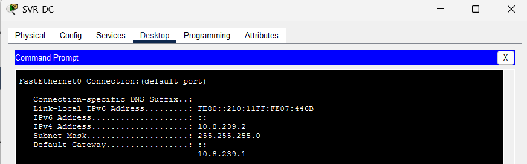

Gambar di atas menunjukkan SVR-DC memakai `10.8.239.2`, mask `255.255.255.0`, dan gateway `10.8.239.1`. Alamat ini tidak berasal dari DHCP, sehingga server pusat tetap dapat dihubungi sebagai DHCP server dan target relay.

##### Konektivitas klien setelah DHCP

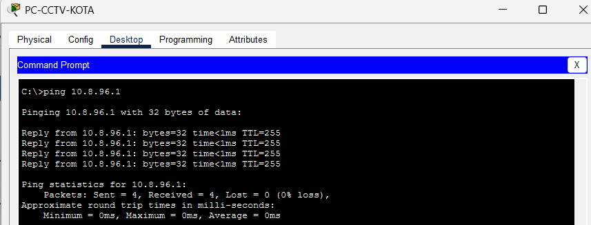

Gambar di atas menunjukkan PC-CCTV-KOTA mendapat `4/4` balasan dari gateway lokal `10.8.96.1`, sehingga lease CCTV dapat dipakai untuk keluar dari subnet.

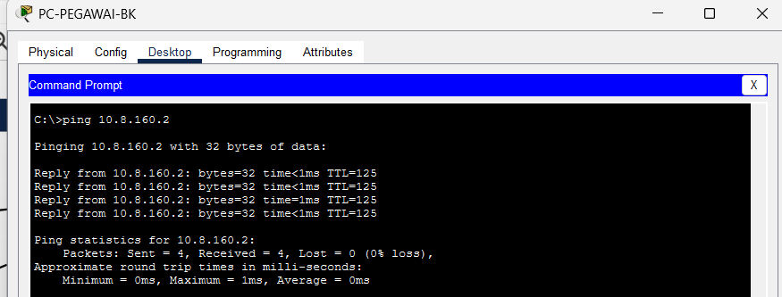

Gambar di atas menunjukkan PC-PEGAWAI-BK (`10.8.224.2`) mendapat `4/4` balasan dari PC-SCADA-PELABUHAN (`10.8.160.2`). Ini membuktikan klien DHCP dari dua LAN berbeda dapat berkomunikasi setelah memperoleh lease.


### 5 - NAT (PAT Overload)

#### Penyelesaian

Seluruh subnet privat `10.8.0.0/16` diterjemahkan oleh R-PUSAT ke satu alamat publik, yaitu `203.0.113.6` pada interface yang mengarah ke R-ISP. Mekanisme yang digunakan adalah PAT/NAT overload, sehingga beberapa host dapat berbagi satu alamat publik dengan nomor port berbeda. R-ISP tidak menyimpan rute ke jaringan privat internal; R-ISP hanya mengetahui dua jaringan yang terhubung langsung, `203.0.113.4/30` dan `8.8.8.0/24`.

##### Konfigurasi R-PUSAT

Fa0/0 yang mengarah ke R-ISP ditetapkan sebagai NAT outside. Semua interface R-PUSAT yang mengarah ke jaringan privat ditetapkan sebagai NAT inside, termasuk link ke router cabang dan interface LAN:

```text
enable
configure terminal
access-list 1 permit 10.8.0.0 0.0.255.255
interface FastEthernet0/0
 ip nat outside
exit
interface FastEthernet0/1
 ip nat inside
exit
interface Ethernet0/0/0
 ip nat inside
exit
interface Ethernet0/1/0
 ip nat inside
exit
interface Ethernet0/2/0
 ip nat inside
exit
interface Ethernet0/3/0
 ip nat inside
exit
interface FastEthernet1/0
 ip nat inside
exit
interface FastEthernet1/1
 ip nat inside
exit
ip nat inside source list 1 interface FastEthernet0/0 overload
end
write memory
```

ACL 1 mencocokkan alamat sumber privat `10.8.0.0/16`. Perintah NAT overload menggunakan alamat interface FastEthernet0/0 R-PUSAT (`203.0.113.6`) sebagai inside-global.

##### Perubahan pada R-ISP

Hapus static route privat yang sebelumnya mengarah ke R-PUSAT. Tidak perlu menambahkan route ke `10.8.0.0/16`:

```text
enable
configure terminal
no ip route 10.8.0.0 255.255.0.0 203.0.113.6
end
write memory
```

Setelah perubahan ini, `show ip route` pada R-ISP hanya menampilkan connected route menuju `203.0.113.4/30` dan `8.8.8.0/24`, tanpa route untuk jaringan `10.8.0.0/16`.

#### Verifikasi

##### Ping 8.8.8.8 dari lima LAN

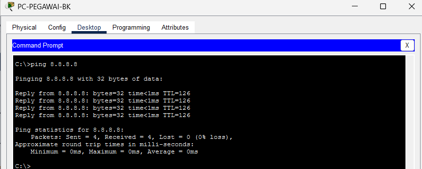

Gambar di atas menunjukkan PC-PEGAWAI-BK mendapat `4/4` balasan dari `8.8.8.8`.

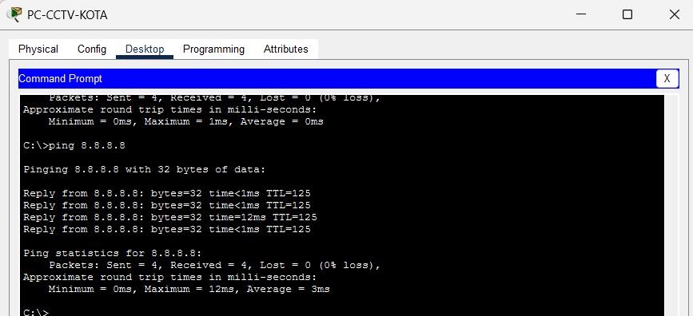

Gambar di atas menunjukkan PC-CCTV-KOTA mendapat `4/4` balasan dari `8.8.8.8`.

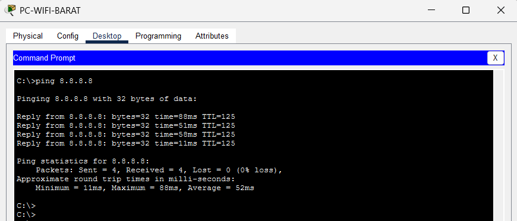

Gambar di atas menunjukkan PC-WIFI-BARAT mendapat `4/4` balasan dari `8.8.8.8`.

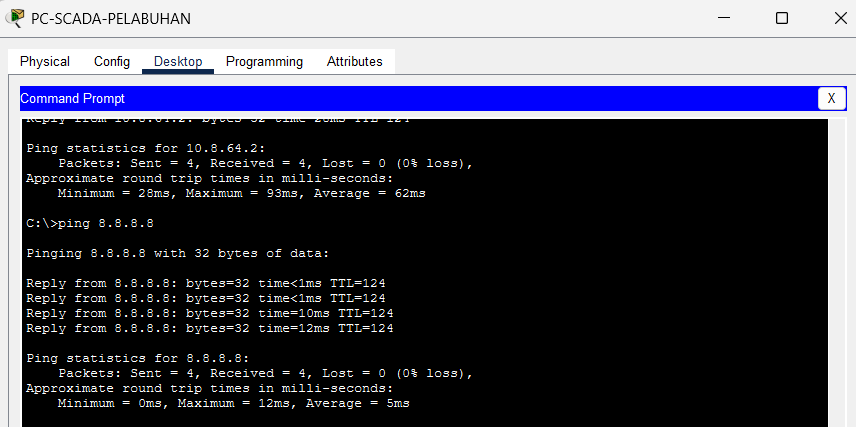

Gambar di atas menunjukkan PC-SCADA-PELABUHAN mendapat `4/4` balasan dari `8.8.8.8`.

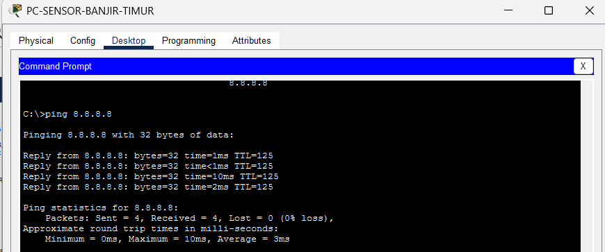

Gambar di atas menunjukkan PC-SENSOR-BANJIR-TIMUR mendapat `4/4` balasan dari `8.8.8.8`.

Kelima gambar di atas mencakup pengujian yang sama dari LAN berbeda: satu LAN lokal R-PUSAT dan empat LAN cabang (CCTV, WiFi Barat, SCADA Pelabuhan, dan Sensor Banjir Timur). Hasil `4/4` pada semua pengujian menunjukkan PAT bekerja lintas subnet.

##### Tabel translasi NAT

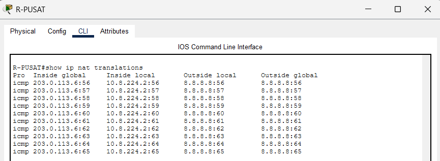

Gambar di atas menampilkan entry dinamis: inside local `10.8.224.2:56` dan host lain diterjemahkan ke inside global `203.0.113.6` dengan port sumber berbeda. Satu alamat publik dipakai bersama oleh beberapa host, sesuai mekanisme PAT overload.

##### Statistik NAT

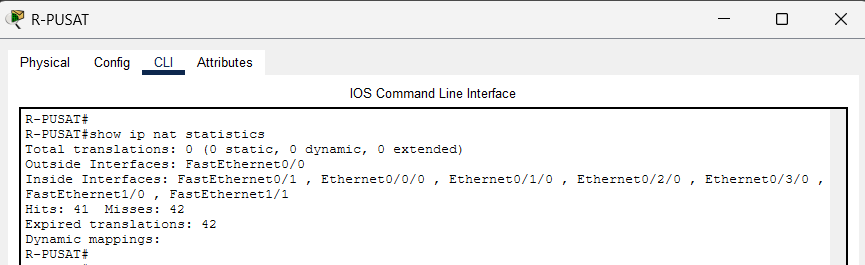

Gambar di atas menampilkan `show ip nat statistics`: outside interface `FastEthernet0/0`, daftar inside interface, `Hits 41`, `Misses 42`, dan `Expired translations 42`. Nilai `Total translations: 0` saat gambar diambil terjadi karena entry dinamis sudah kedaluwarsa; angka `Hits` dan `Expired` menunjukkan translasi pernah terbentuk dan dipakai.

##### Rute pada R-ISP

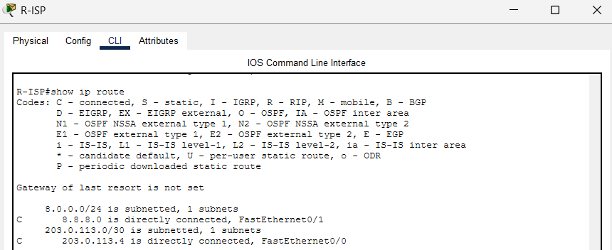

Gambar di atas menunjukkan tabel routing R-ISP hanya berisi connected `8.8.8.0/24` dan `203.0.113.4/30`. Tidak ada route `10.8.0.0/16`, sehingga R-ISP tidak mengetahui jaringan privat internal dan hanya meneruskan balasan ke alamat publik hasil NAT.


### 6 - GRE Tunnel R-PUSAT ke R-PELABUHAN

#### Penyelesaian

GRE menggunakan subnet tunnel Kelompok 1 `192.168.1.0/30`: alamat R-PUSAT `192.168.1.1` dan R-PELABUHAN `192.168.1.2`. Alamat endpoint underlay mengikuti interface fisik yang benar-benar terhubung di file Packet Tracer, bukan contoh alamat pada panduan yang tidak cocok dengan topologi aktif:

| Router | Interface fisik | IP underlay aktif | Fungsi |
| :--- | :--- | :--- | :--- |
| R-PUSAT | Ethernet0/1/0 | `10.8.241.45/30` | source tunnel; link ke R-UTARA |
| R-PELABUHAN | FastEthernet0/0 | `10.8.241.58/30` | source tunnel; link ke R-UTARA |

Alamat `10.8.241.54` pada panduan adalah R-SELATAN, bukan R-PELABUHAN. Link L6 aktif pada file ini adalah `10.8.241.56/30`: R-UTARA `10.8.241.57` dan R-PELABUHAN `10.8.241.58`; next-hop R-UTARA dari R-PUSAT adalah `10.8.241.46` (bukan `.38`, yang merupakan R-DC). Tunnel memakai endpoint R-PUSAT `10.8.241.45` dan R-PELABUHAN `10.8.241.58`.

Pada Packet Tracer, paket GRE dikirim berdasarkan hasil ARP untuk alamat tujuan tunnel pada interface source. Jika source diarahkan ke `FastEthernet1/1` (`10.8.241.37`, link ke R-DC), ARP untuk `10.8.241.58` dijawab proxy ARP oleh R-DC sehingga paket GRE berputar ke R-DC, bukan ke R-UTARA. Karena itu source memakai interface yang benar-benar menuju R-UTARA, yaitu `Ethernet0/1/0` (`10.8.241.45`). Entry ARP lama pada `FastEthernet1/1` juga dibersihkan dengan bounce interface sebelum pengujian. Setelah kedua hal itu diperbaiki, tunnel berfungsi.

Konfigurasi Tunnel0 pada tahap soal 6 (historis; route internal ini digantikan OSPF pada soal 7):

```text
enable
configure terminal
interface Tunnel0
 ip address 192.168.1.1 255.255.255.252
 tunnel source Ethernet0/1/0
 tunnel destination 10.8.241.58
 no shutdown
exit
ip route 10.8.241.56 255.255.255.252 10.8.241.46
ip route 10.8.241.58 255.255.255.255 10.8.241.46
no ip route 10.8.160.0 255.255.224.0 10.8.241.46
no ip route 10.8.240.0 255.255.255.128 10.8.241.46
ip route 10.8.160.0 255.255.224.0 192.168.1.2
ip route 10.8.240.0 255.255.255.128 192.168.1.2
end
write memory
```

Pada tahap soal 6, static route underlay menuju endpoint `10.8.241.58` melalui R-UTARA `10.8.241.46` menjaga peer GRE tetap terjangkau. Pada konfigurasi akhir soal 7, route subnet underlay tersebut dipelajari melalui OSPF.

Konfigurasi Tunnel0 pada tahap soal 6 (historis; route internal ini digantikan OSPF pada soal 7):

```text
enable
configure terminal
interface Tunnel0
 ip address 192.168.1.2 255.255.255.252
 tunnel source FastEthernet0/0
 tunnel destination 10.8.241.45
 no shutdown
exit
ip route 10.8.241.44 255.255.255.252 10.8.241.57
ip route 10.8.241.45 255.255.255.255 10.8.241.57
ip route 10.8.224.0 255.255.248.0 192.168.1.1
ip route 10.8.241.0 255.255.255.224 192.168.1.1
end
write memory
```

Rute di atas adalah konfigurasi historis soal 6, sebelum migrasi OSPF dan penambahan ring pada soal 7. Konfigurasi GRE/IPsec tetap tersimpan, tetapi pengujian setelah perubahan soal 7 menunjukkan `ping 192.168.1.2` gagal `0/5`; SA IPsec aktif hanya teramati pada R-PUSAT dan belum terbentuk pada R-PELABUHAN. Dengan demikian tunnel tidak diklaim sebagai jalur aktif pada konfigurasi akhir. Routing LAN dan failover saat ini menggunakan OSPF pada link fisik.

GRE hanya melakukan enkapsulasi paket ke dalam header IP baru. GRE sendiri tidak menyediakan kerahasiaan, integritas kriptografis, atau autentikasi kuat; payload tidak terenkripsi tanpa IPsec.

#### Verifikasi

##### Jalur underlay ke endpoint tunnel

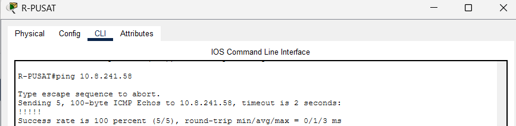

Gambar di atas menunjukkan R-PUSAT mendapat `5/5` balasan dari `10.8.241.58`, yaitu interface underlay R-PELABUHAN.

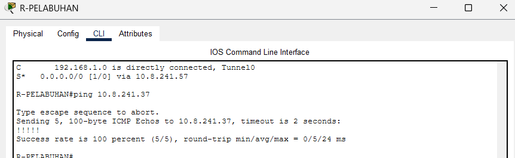

Gambar di atas menunjukkan R-PELABUHAN mendapat `5/5` balasan dari `10.8.241.37` (R-PUSAT). Tabel routing juga memperlihatkan `192.168.1.0/30` terhubung ke `Tunnel0` dan default route via `10.8.241.57`. Jalur fisik dari R-PELABUHAN menuju R-PUSAT dapat dijangkau; ping tunnel berikutnya menguji pasangan endpoint `10.8.241.45`–`10.8.241.58`.

##### Ping tunnel dua arah

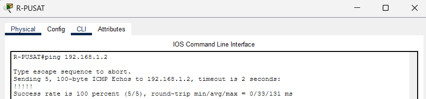

Gambar di atas menunjukkan R-PUSAT mendapat `5/5` balasan dari alamat tunnel R-PELABUHAN `192.168.1.2`.

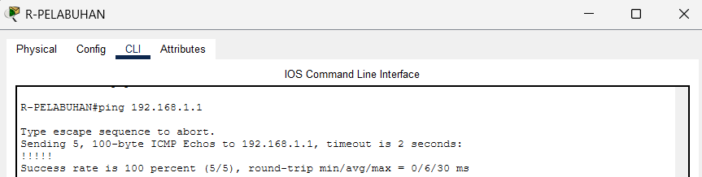

Gambar di atas menunjukkan R-PELABUHAN mendapat `5/5` balasan dari alamat tunnel R-PUSAT `192.168.1.1`. Kedua ping melalui `Tunnel0`; pada pengujian CLI, counter input `Tunnel0` ikut bertambah. Status `up/up` saja tidak membuktikan bahwa paket GRE benar-benar lewat.

##### Komunikasi host Balai Kota–Pelabuhan

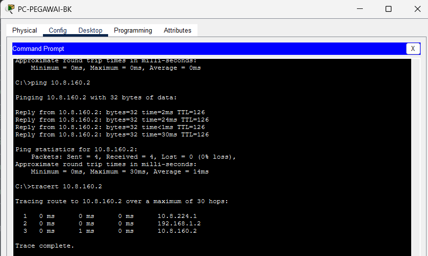

Gambar di atas menunjukkan PC-PEGAWAI-BK (`10.8.224.2`) mendapat `4/4` balasan dari PC-SCADA-PELABUHAN (`10.8.160.2`). `tracert` melewati `10.8.224.1` → `192.168.1.2` → `10.8.160.2`.

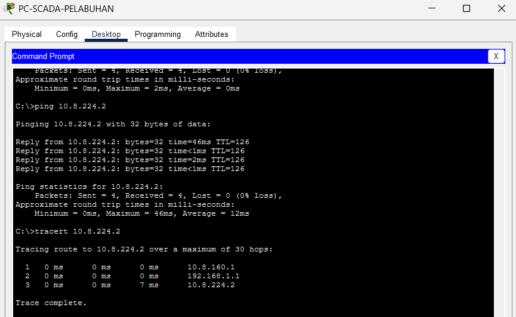

Gambar di atas menunjukkan arah balik dari PC-SCADA-PELABUHAN (`10.8.160.2`) ke PC-PEGAWAI-BK (`10.8.224.2`) juga mendapat `4/4` balasan. Hop `192.168.1.1` pada `tracert` membuktikan trafik balik melewati `Tunnel0`.

#### Bonus IPsec over GRE

IPsec diterapkan untuk mengenkripsi paket GRE antara R-PUSAT `10.8.241.45` dan R-PELABUHAN `10.8.241.58`. Pada Packet Tracer 9.0.1, `crypto ipsec profile` dan `tunnel protection ipsec profile` tidak tersedia, sehingga IPsec dipasang lewat **crypto map** pada interface fisik underlay dengan ACL yang mencocokkan protokol GRE (`gre`, protokol 47). Paket GRE yang membawa trafik Balai Kota–Pelabuhan dienkapsulasi lagi ke dalam ESP.

Konfigurasi R-PUSAT:

```text
crypto isakmp policy 10
 encr aes
 hash sha
 authentication pre-share
 group 2
 lifetime 86400
exit
crypto isakmp key JARKOM123 address 10.8.241.58
crypto ipsec transform-set TS-GRE esp-aes esp-sha-hmac
exit
access-list 101 permit gre host 10.8.241.45 host 10.8.241.58
crypto map CMAP 10 ipsec-isakmp
 set peer 10.8.241.58
 set transform-set TS-GRE
 match address 101
exit
interface Ethernet0/1/0
 crypto map CMAP
exit
```

Konfigurasi R-PELABUHAN:

```text
crypto isakmp policy 10
 encr aes
 hash sha
 authentication pre-share
 group 2
 lifetime 86400
exit
crypto isakmp key JARKOM123 address 10.8.241.45
crypto ipsec transform-set TS-GRE esp-aes esp-sha-hmac
exit
access-list 101 permit gre host 10.8.241.58 host 10.8.241.45
crypto map CMAP 10 ipsec-isakmp
 set peer 10.8.241.45
 set transform-set TS-GRE
 match address 101
exit
interface FastEthernet0/0
 crypto map CMAP
exit
```

##### Verifikasi IPsec

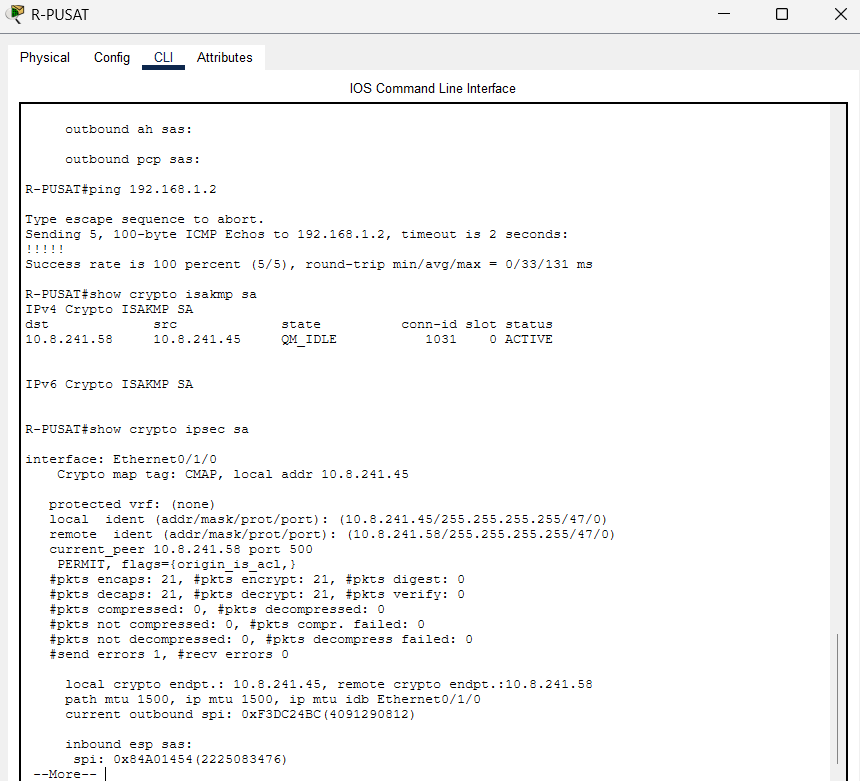

Gambar di atas menunjukkan output R-PUSAT: `show crypto isakmp sa` berstatus `QM_IDLE ACTIVE`, `show crypto ipsec sa` berstatus `ACTIVE`, dan counter `encaps/encrypt` serta `decaps/decrypt` bertambah (pada gambar tercatat 21/21). Ping `192.168.1.2` pada layar yang sama mendapat `5/5` balasan. Pemeriksaan yang sama pada R-PELABUHAN menunjukkan ISAKMP SA dan IPsec SA berstatus `ACTIVE`, sehingga kedua ujung tunnel memakai sesi IPsec yang sama.

### 7 - Dynamic Routing OSPF

#### Deskripsi

* Tambahkan link cadangan L7 antara R-DC dan R-UTARA menggunakan subnet yang belum terpakai.
* Tambahkan L8–L11 agar setiap link backbone memiliki jalur alternatif saat satu link putus.
* Ganti static route antar-router dengan OSPF; jangan kirim hello OSPF ke arah LAN pengguna.
* Konfigurasikan default route internet hanya di R-PUSAT dan sebarkan otomatis kepada router lain melalui OSPF.
* Pulihkan konektivitas otomatis melalui jalur lain ketika satu link backbone putus.

#### Penyelesaian

Soal ini menambahkan link cadangan L7 antara R-DC dan R-UTARA dan mengganti static route internal dengan OSPF process 1, Area 0. Alamat L7 mengikuti topologi CPT yang aktif: `10.8.241.60/30`, dengan R-DC `10.8.241.61` dan R-UTARA `10.8.241.62`. Blok `10.8.241.56/30` sudah dipakai link L6 R-UTARA–R-PELABUHAN. Agar link L3–L6 juga memiliki jalur alternatif, ditambahkan L8–L11 yang menghubungkan cabang-cabang dalam ring.

Port router tambahan menggunakan modul `HWIC-1GE-SFP` pada slot `0/0` dan, untuk router yang memerlukan dua port, slot `0/1`. Semua link baru memakai kabel fiber dan mask `255.255.255.252`. Interface L8–L11 menggunakan OSPF cost `100`, sehingga jalur ring berfungsi sebagai cadangan dan tidak mengalahkan path lama pada kondisi normal.

| Link | Interface pertama | Interface kedua | Prefix |
| :--- | :--- | :--- | :--- |
| L7 DC–UTARA | R-DC `GigabitEthernet0/0/0` - `10.8.241.61` | R-UTARA `GigabitEthernet0/0/0` - `10.8.241.62` | `10.8.241.60/30` |
| L8 PELABUHAN–TIMUR | R-PELABUHAN `GigabitEthernet0/0/0` - `10.8.241.65` | R-TIMUR `GigabitEthernet0/0/0` - `10.8.241.66` | `10.8.241.64/30` |
| L9 TIMUR–SELATAN | R-TIMUR `GigabitEthernet0/1/0` - `10.8.241.69` | R-SELATAN `GigabitEthernet0/0/0` - `10.8.241.70` | `10.8.241.68/30` |
| L10 SELATAN–BARAT | R-SELATAN `GigabitEthernet0/1/0` - `10.8.241.73` | R-BARAT `GigabitEthernet0/0/0` - `10.8.241.74` | `10.8.241.72/30` |
| L11 BARAT–DC | R-BARAT `GigabitEthernet0/1/0` - `10.8.241.77` | R-DC `GigabitEthernet0/1/0` - `10.8.241.78` | `10.8.241.76/30` |

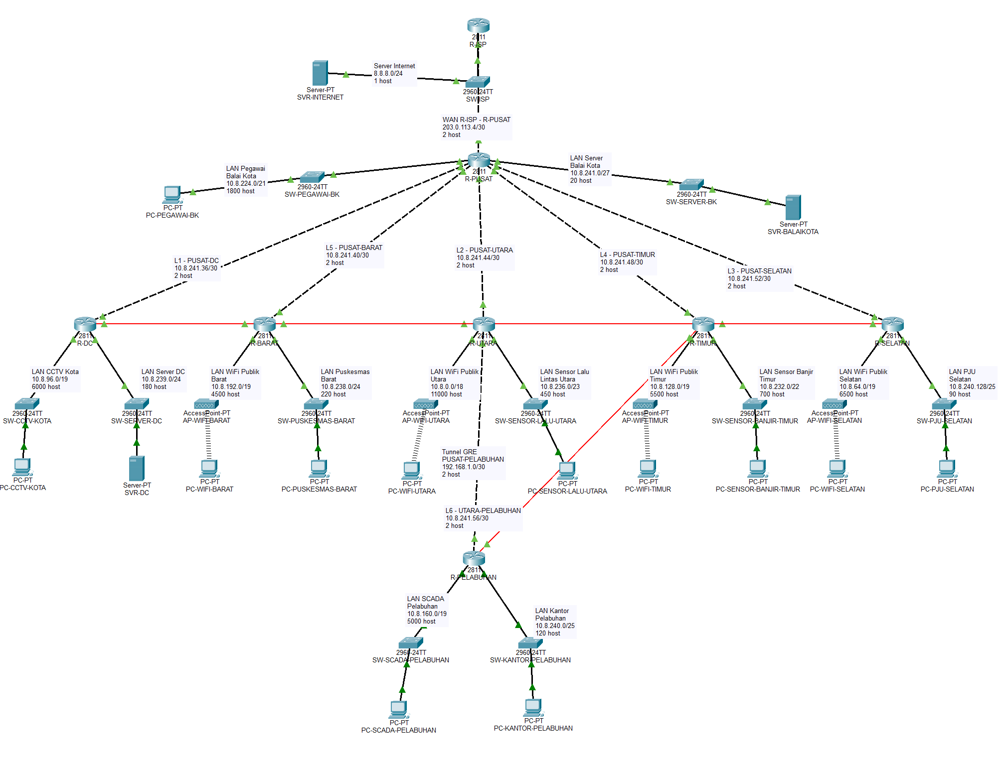

Garis merah pada gambar menunjukkan link fiber redundan L7–L11; L8–L11 melengkapi jalur alternatif bagi cabang lain.

OSPF memakai `passive-interface default`; hanya interface backbone router-ke-router dibuka dengan `no passive-interface`. Dengan demikian subnet LAN tetap diiklankan ke OSPF, tetapi router tidak mengirim hello OSPF ke PC, AP, switch LAN, atau server. R-PUSAT satu-satunya router dengan default route statis ke R-ISP dan mengiklankannya menggunakan `default-information originate`. R-ISP tidak menjalankan OSPF.

Subnet underlay yang memuat endpoint GRE/IPsec diiklankan melalui OSPF, sehingga kedua peer tetap dapat dijangkau tanpa static route host tambahan. Default route internet adalah satu-satunya static route yang tersisa di router internal, yaitu pada R-PUSAT. Traffic LAN Balai Kota–Pelabuhan pada tahap ini mengikuti jalur OSPF fisik, bukan static route Tunnel0 dari tahap soal 6.

##### Interface link baru

Konfigurasi alamat interface L7–L11 (semua interface `no shutdown`):

| Router | Interface | Alamat |
| :--- | :--- | :--- |
| R-DC | GigabitEthernet0/0/0 | `10.8.241.61/30` |
| R-DC | GigabitEthernet0/1/0 | `10.8.241.78/30` |
| R-UTARA | GigabitEthernet0/0/0 | `10.8.241.62/30` |
| R-PELABUHAN | GigabitEthernet0/0/0 | `10.8.241.65/30` |
| R-TIMUR | GigabitEthernet0/0/0 | `10.8.241.66/30` |
| R-TIMUR | GigabitEthernet0/1/0 | `10.8.241.69/30` |
| R-SELATAN | GigabitEthernet0/0/0 | `10.8.241.70/30` |
| R-SELATAN | GigabitEthernet0/1/0 | `10.8.241.73/30` |
| R-BARAT | GigabitEthernet0/0/0 | `10.8.241.74/30` |
| R-BARAT | GigabitEthernet0/1/0 | `10.8.241.77/30` |

##### Konfigurasi OSPF R-PUSAT

R-PUSAT mengiklankan LAN Pegawai Balai Kota, LAN Server Balai Kota, dan subnet backbone internal. Keduanya tetap passive, sehingga tidak mengirim hello OSPF ke perangkat LAN. WAN `203.0.113.4/30` dan `Tunnel0` tidak dimasukkan ke OSPF. Default route tetap menunjuk ke R-ISP.

```text
enable
configure terminal
router ospf 1
 router-id 1.1.1.1
 passive-interface default
 no passive-interface Ethernet0/0/0
 no passive-interface Ethernet0/1/0
 no passive-interface Ethernet0/2/0
 no passive-interface Ethernet0/3/0
 no passive-interface FastEthernet1/1
 network 10.8.224.0 0.0.7.255 area 0
 network 10.8.241.0 0.0.0.63 area 0
 default-information originate
exit
ip route 0.0.0.0 0.0.0.0 203.0.113.5
end
write memory
```

##### Konfigurasi OSPF router cabang

Jalankan blok sesuai router. Semua interface LAN bersifat passive; perintah `no passive-interface` hanya membuka link backbone. R-PELABUHAN tersambung ke R-UTARA melalui L6 dan ke R-TIMUR melalui L8.

**R-DC:**
```text
router ospf 1
 router-id 2.2.2.2
 passive-interface default
 no passive-interface FastEthernet0/0
 no passive-interface GigabitEthernet0/0/0
 no passive-interface GigabitEthernet0/1/0
 network 10.8.96.0 0.0.31.255 area 0
 network 10.8.239.0 0.0.0.255 area 0
 network 10.8.241.36 0.0.0.3 area 0
 network 10.8.241.60 0.0.0.3 area 0
 network 10.8.241.76 0.0.0.3 area 0
```

**R-UTARA:**
```text
router ospf 1
 router-id 3.3.3.3
 passive-interface default
 no passive-interface FastEthernet0/0
 no passive-interface FastEthernet1/1
 no passive-interface GigabitEthernet0/0/0
 network 10.8.0.0 0.0.63.255 area 0
 network 10.8.236.0 0.0.1.255 area 0
 network 10.8.241.44 0.0.0.3 area 0
 network 10.8.241.56 0.0.0.3 area 0
 network 10.8.241.60 0.0.0.3 area 0
```

**R-PELABUHAN:**
```text
router ospf 1
 router-id 4.4.4.4
 passive-interface default
 no passive-interface FastEthernet0/0
 no passive-interface GigabitEthernet0/0/0
 network 10.8.160.0 0.0.31.255 area 0
 network 10.8.240.0 0.0.0.127 area 0
 network 10.8.241.56 0.0.0.3 area 0
 network 10.8.241.64 0.0.0.3 area 0
```

**R-SELATAN:**
```text
router ospf 1
 router-id 5.5.5.5
 passive-interface default
 no passive-interface FastEthernet0/0
 no passive-interface GigabitEthernet0/0/0
 no passive-interface GigabitEthernet0/1/0
 network 10.8.64.0 0.0.31.255 area 0
 network 10.8.240.128 0.0.0.127 area 0
 network 10.8.241.52 0.0.0.3 area 0
 network 10.8.241.68 0.0.0.3 area 0
 network 10.8.241.72 0.0.0.3 area 0
```

**R-TIMUR:**
```text
router ospf 1
 router-id 6.6.6.6
 passive-interface default
 no passive-interface FastEthernet0/0
 no passive-interface GigabitEthernet0/0/0
 no passive-interface GigabitEthernet0/1/0
 network 10.8.128.0 0.0.31.255 area 0
 network 10.8.232.0 0.0.3.255 area 0
 network 10.8.241.48 0.0.0.3 area 0
 network 10.8.241.64 0.0.0.3 area 0
 network 10.8.241.68 0.0.0.3 area 0
```

**R-BARAT:**
```text
router ospf 1
 router-id 7.7.7.7
 passive-interface default
 no passive-interface FastEthernet0/0
 no passive-interface GigabitEthernet0/0/0
 no passive-interface GigabitEthernet0/1/0
 network 10.8.192.0 0.0.31.255 area 0
 network 10.8.238.0 0.0.0.255 area 0
 network 10.8.241.40 0.0.0.3 area 0
 network 10.8.241.72 0.0.0.3 area 0
 network 10.8.241.76 0.0.0.3 area 0
```

Sebelum migrasi, hapus static route antar-router dan default route cabang dengan `no ip route` yang cocok persis dengan konfigurasi lama pada masing-masing router. Pertahankan hanya default route R-PUSAT ke `203.0.113.5`; jangan sisakan static route untuk subnet internal atau endpoint GRE. Setelah konfigurasi, simpan setiap router dengan `write memory`.

#### Verifikasi

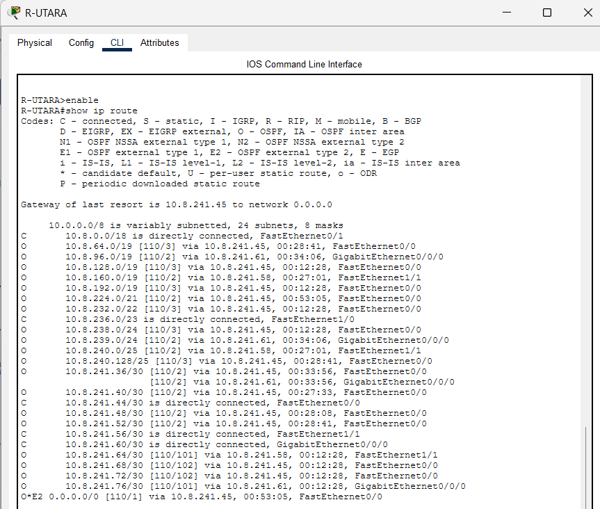

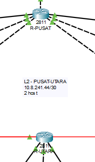

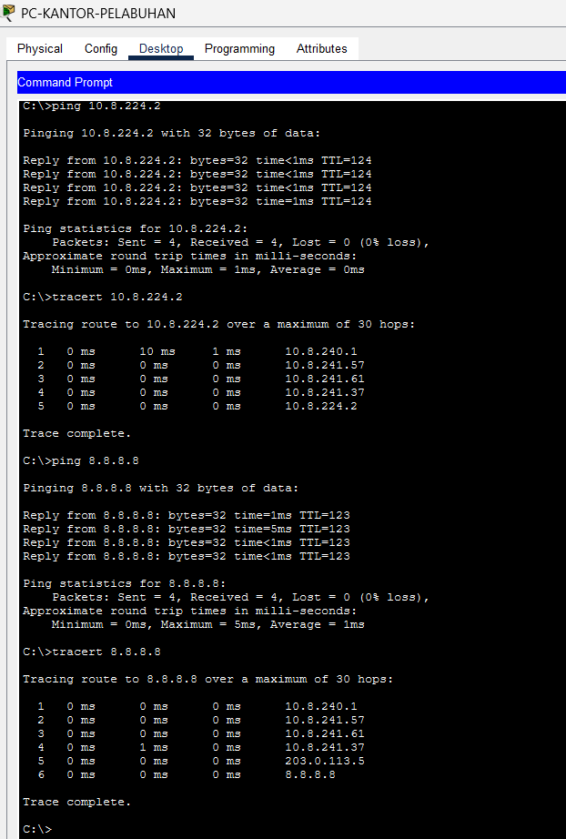

##### Neighbor dan default route OSPF

Pada keadaan normal, neighbor OSPF mencapai `FULL` pada link backbone. Tabel routing R-DC, R-UTARA, R-PELABUHAN, R-BARAT, R-TIMUR, dan R-SELATAN memuat route `O` ke LAN lain dan `O*E2 0.0.0.0/0` yang berasal dari R-PUSAT. Interface LAN tetap passive; adjacency hanya terbentuk melalui backbone.

##### Failover saat L1 R-PUSAT–R-DC putus

Pengujian dilakukan dengan `shutdown` sementara pada `FastEthernet1/1` R-PUSAT. Setelah OSPF reconverge, R-DC memilih next-hop L7 `10.8.241.62` untuk menuju jaringan R-PUSAT dan default route. Ping R-DC ke `10.8.224.2` berhasil `5/5`, dan PC-CCTV-KOTA tetap mendapat `4/4` balasan dari `8.8.8.8`. L1 kemudian diaktifkan kembali.

##### Failover saat L2 R-PUSAT–R-UTARA putus

Pengujian dilakukan dengan `shutdown` sementara pada `Ethernet0/1/0` R-PUSAT. Setelah OSPF reconverge, R-UTARA memilih next-hop L7 R-DC `10.8.241.61` untuk menuju R-PUSAT. Ping R-UTARA ke `10.8.224.2` berhasil `5/5`, dan PC-WIFI-UTARA mendapat `4/4` balasan dari `8.8.8.8`. L2 kemudian diaktifkan kembali.

##### Failover link L3–L6

Setiap link diuji satu per satu dengan `shutdown` sementara, lalu diaktifkan kembali sebelum pengujian berikutnya. Setelah OSPF reconverge, router yang terdampak tetap memiliki default route dari R-PUSAT dan ping ke `10.8.224.2` berhasil `5/5`:

| Link putus | Router terdampak | Next-hop alternatif yang teramati |
| :--- | :--- | :--- |
| L3 PUSAT–SELATAN | R-SELATAN | R-TIMUR `10.8.241.69` atau R-BARAT `10.8.241.74` |
| L4 PUSAT–TIMUR | R-TIMUR | R-PELABUHAN `10.8.241.65` atau R-SELATAN `10.8.241.70` |
| L5 PUSAT–BARAT | R-BARAT | R-SELATAN `10.8.241.73` atau R-DC `10.8.241.78` |
| L6 UTARA–PELABUHAN | R-PELABUHAN | R-TIMUR `10.8.241.66` |

Ring L7–L11 menyediakan alternatif untuk kegagalan satu link backbone. Jalur R-PUSAT ke R-ISP tetap tunggal; jika WAN internet itu putus, link internal tidak dapat menggantikan koneksi ISP.

Catatan pengujian akhir OSPF: ping LAN lintas jaringan dan akses internet dari Pelabuhan berhasil. Ping R-PUSAT ke endpoint underlay R-PELABUHAN `10.8.241.58` dan ping Tunnel0 `192.168.1.2` gagal (`0/5`); SA IPsec aktif hanya terlihat pada R-PUSAT dan belum terbentuk pada R-PELABUHAN. GRE/IPsec tetap memerlukan pemulihan sebelum dapat dipakai sebagai jalur layanan.

### 8 - Layanan Aplikasi Smart City

#### Domain dan pemetaan server

Domain internal yang digunakan adalah `k1.smartcity.lab` (Kelompok 1). Alamat statis server sudah sesuai dengan LAN aktif Packet Tracer:

| Server | Fungsi | Alamat/mask | Gateway | DNS |
| :--- | :--- | :--- | :--- | :--- |
| SVR-DC | DHCP, DNS, FTP, email | `10.8.239.2/24` | `10.8.239.1` | `10.8.239.2` |
| SVR-BALAIKOTA | Portal HTTP/HTTPS | `10.8.241.2/27` | `10.8.241.1` | `10.8.239.2` |

#### DNS

DNS service aktif pada SVR-DC. A record berikut dapat diakses dari klien yang memakai DNS `10.8.239.2`:

| Nama | Tipe | Alamat |
| :--- | :--- | :--- |
| `www.k1.smartcity.lab` | A | `10.8.241.2` |
| `ftp.k1.smartcity.lab` | A | `10.8.239.2` |
| `mail.k1.smartcity.lab` | A | `10.8.239.2` |

Konfigurasi layanan soal 8 diterapkan pada `K1_VLSM_OSPF.pkt` dan `K1_VLSM.pkt`. Pada kedua file, semua DHCP pool router dan kedua pool DHCP SVR-DC (`serverPool` dan `CCTV-KOTA`) membagikan DNS `10.8.239.2`. Lease PC CCTV-KOTA, PC Pegawai Balai Kota, dan PC Kantor Pelabuhan diperbarui pada masing-masing file.

#### Portal web

HTTP dan HTTPS aktif pada SVR-BALAIKOTA. Berkas `index.html` menampilkan:

```html
<h1>Portal Smart City Surabaya</h1>
<h2>Kelompok 1 (k1.smartcity.lab)</h2>
<p>Layanan Terintegrasi Pemerintah Kota Surabaya</p>
```

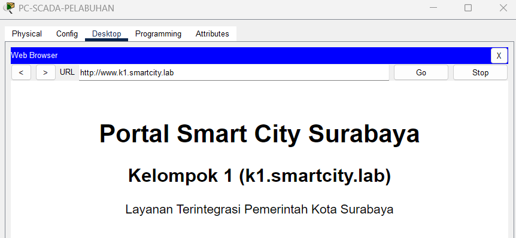

#### FTP rekaman CCTV

FTP aktif pada SVR-DC. Akun `cctv` dibuat dengan password `cctv123` dan hak akses `RWDNL` (Read, Write, Delete, Rename, List). Dari PC-CCTV-KOTA, login ke `ftp.k1.smartcity.lab` berhasil, `rekaman01.txt` berhasil diunggah , dan file tampil pada hasil `dir` FTP server.

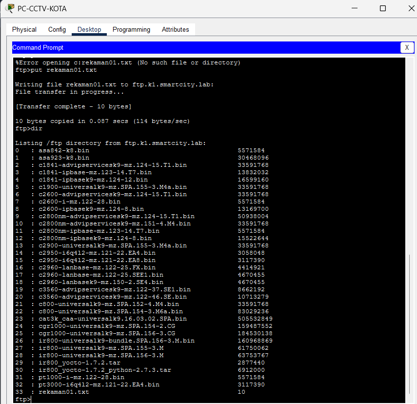

#### Email antarpegawai

SMTP dan POP3 aktif pada SVR-DC dengan domain `k1.smartcity.lab`. Akun server:

| Pengguna | Alamat email | Username | Password |
| :--- | :--- | :--- | :--- |
| Balai Kota | `balaikota@k1.smartcity.lab` | `balaikota` | `12345` |
| Pelabuhan | `pelabuhan@k1.smartcity.lab` | `pelabuhan` | `12345` |

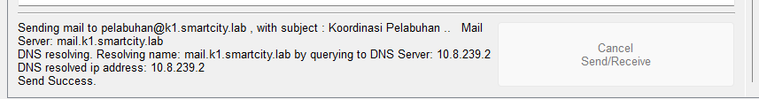

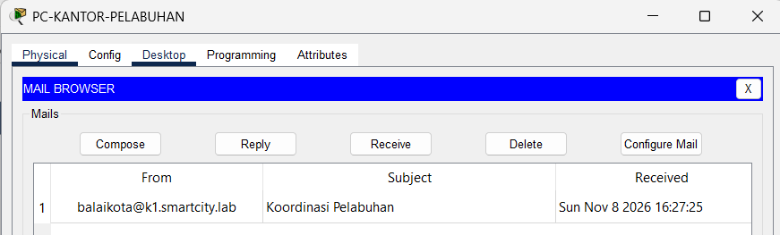


